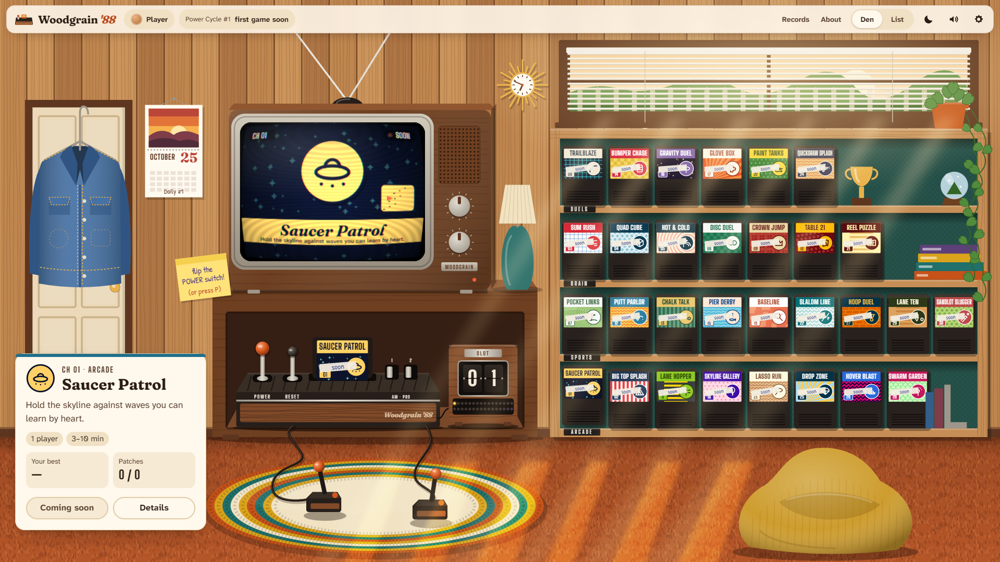
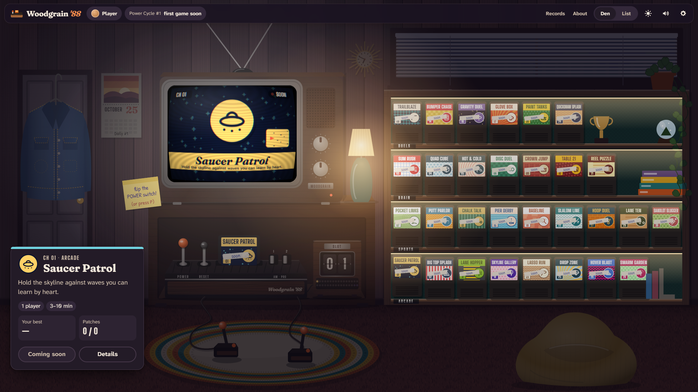
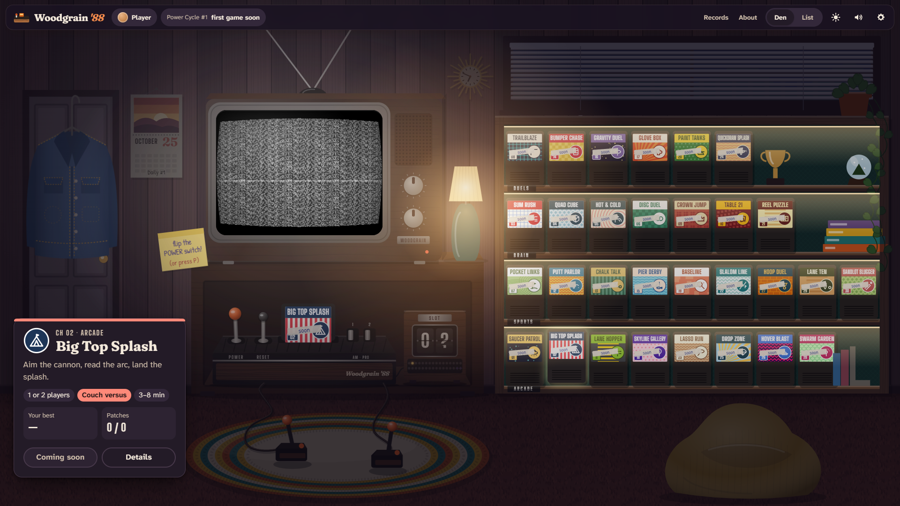

# Woodgrain '88

**Thirty little games from one 1988 cartridge, reborn for today. Flip the power switch and see what
comes on.**



In 1988 a cartridge called "32 in 1" had no menu: every time you switched the console on, a
different game came up. We studied every one of them and built each again from scratch, in new code,
with new art, sound and levels, for people who play now and for the ones who played then.

**30 games, not 32 — and how we found out.** Comparing the 32 programs byte by byte turned up two
near-twins: a road-crossing game that appears twice with a new hero, and a fishing game that appears
twice with new colours and its difficulty switches swapped. So the cartridge really holds 30 games.
Here the twins come back as hidden variants, and finding them lights the last two lamps on the
Counter.



## The power switch

Click the POWER lever, drag it, or press **P** (Shift+P goes back, holding P keeps flipping): the
picture collapses to a dot, the set warms up through snow, the Counter flips to the next slot, and
the next game's picture rolls in. The Label Wall is the precise way in: hover or focus a cartridge
and the TV changes channel.



## The games

<!-- games:start -->

| Slot | Game             | Family | Players            | Status      | In one line                                                   |
| ---- | ---------------- | ------ | ------------------ | ----------- | ------------------------------------------------------------- |
| 01   | Saucer Patrol    | Arcade | 1                  | coming soon | Hold the skyline against waves you can learn by heart.        |
| 02   | Big Top Splash   | Arcade | 1–2 (couch versus) | coming soon | Aim the cannon, read the arc, land the splash.                |
| 03   | Sum Rush         | Brain  | 1                  | coming soon | Quick sums, gentle for kids and fierce for grown-ups.         |
| 04   | Quad Cube        | Brain  | 1–2 (couch versus) | coming soon | Four in a row, in a cube of glass you can turn in your hands. |
| 05   | Hot & Cold       | Brain  | 1–2 (couch versus) | coming soon | Find the hidden flag with clues that paint the board.         |
| 06   | Disc Duel        | Brain  | 1–2 (couch versus) | coming soon | Flip the board in one move, if you can see it coming.         |
| 07   | Pocket Links     | Sports | 1–2 (couch versus) | coming soon | Nine holes, a breeze you can read, a swing in three clicks.   |
| 08   | Trailblaze       | Duels  | 1–2 (couch versus) | coming soon | Leave a trail of light and box your rival in.                 |
| 09   | Crown Jump       | Brain  | 1–2 (couch versus) | coming soon | Chain the jumps in one sweep and crown your king.             |
| 10   | Table 21         | Brain  | 1–2 (couch versus) | coming soon | Card sense, coached kindly. Chips are just the score.         |
| 11   | Lane Hopper      | Arcade | 1–2 (couch versus) | coming soon | Race a friend across ten lanes of traffic.                    |
| 12   | Putt Parlor      | Sports | 1–2 (couch versus) | coming soon | Toy-box mini golf with moving obstacles we built ourselves.   |
| 13   | Chalk Talk       | Sports | 1–2 (couch versus) | coming soon | Call the play on a chalkboard, then watch it run.             |
| 14   | Bumper Chase     | Duels  | 2 (couch versus)   | coming soon | Two cars, one maze, and soft foam darts.                      |
| 15   | Pier Derby       | Sports | 1–2 (couch versus) | coming soon | Two anglers, one pier, one hungry shark to dodge.             |
| 16   | Gravity Duel     | Duels  | 2 (couch versus)   | coming soon | Two ships, one star, and orbits you learn by feel.            |
| 17   | Glove Box        | Duels  | 1–2 (couch versus) | coming soon | Cartoon boxing scored on clean hits. Bells, not bruises.      |
| 18   | Skyline Gallery  | Arcade | 1–2 (couch versus) | coming soon | A harbour fair of balloons, kites and toy boats.              |
| 19   | Baseline         | Sports | 1–2 (couch versus) | coming soon | Two-button tennis where the angle comes from your timing.     |
| 20   | Paint Tanks      | Duels  | 2 (couch versus)   | coming soon | Toy tanks in a diorama that splat paint on each other.        |
| 21   | Reel Puzzle      | Brain  | 1                  | coming soon | A timing and pattern puzzle. No bets, no credits.             |
| 22   | Slalom Line      | Sports | 1                  | coming soon | Carve the gates on a fresh mountain every run.                |
| 23   | Lasso Run        | Arcade | 1                  | coming soon | Round up the herd to the rhythm of hooves.                    |
| 24   | Quickdraw Splash | Duels  | 1–2 (couch versus) | coming soon | High noon, water pistols, and a cactus to hide behind.        |
| 25   | Drop Zone        | Arcade | 1–2 (couch versus) | coming soon | Read the wind and land on the moving target.                  |
| 26   | Hover Blast      | Arcade | 1                  | coming soon | A hovercraft against ground drones in a neon canyon.          |
| 27   | Hoop Duel        | Sports | 1–2 (couch versus) | coming soon | One-on-one street ball with a shot arc you can feel.          |
| 28   | Swarm Garden     | Arcade | 1                  | coming soon | Steer the swarm away from the picnic before it builds a nest. |
| 29   | Lane Ten         | Sports | 1–2 (couch versus) | coming soon | Ten-pin with spin you steer after release.                    |
| 30   | Sandlot Slugger  | Sports | 1–2 (couch versus) | coming soon | Backyard baseball with pitch types and an eye you train.      |

<!-- games:end -->

## Run it

```sh
pnpm install
pnpm dev          # The Den on http://localhost:4488
pnpm build        # the static site in hall/dist (BASE_PATH=/woodgrain-88/ for GitHub Pages)
pnpm preview      # the built site on http://localhost:5488
```

## Check it

```sh
pnpm lint         # ESLint and Prettier
pnpm typecheck    # TypeScript strict, every package
pnpm test         # Vitest for the kit, the Hall and the scripts, plus the crew bridge's tests
pnpm check        # guardrails: no raster, no brands, storage only through the store, nothing private published
pnpm e2e          # build, then Playwright against the site and the test harness
pnpm docs:games   # rewrite the game list above from the registry
```

`hall/harness.html` (dev server only) is the Hall with a test-only fake game in slot 20, used to
prove the whole play → pause → results loop. It is never built.

## How it is made

Each Claude Code session leads the work: architecture, art, game feel and review. Routine coding,
tests and the research notes on each original go to a crew of Gemini models through a small bridge
that keeps each task inside its own folders and runs its tests. See
[the team protocol](docs/team/PROTOCOL.md), the [architecture](docs/ARCHITECTURE.md) and the
[decisions](docs/adr/).

Everything you see and hear is drawn and synthesised in your browser. There are no images, audio
files or network calls, and it works offline after the first visit.

## Credits and licence

The original games belong to their publishers; see [CREDITS.md](CREDITS.md). Code is MIT
([LICENSE](LICENSE)); our art, music and words are CC BY 4.0 ([LICENSE-ASSETS.md](LICENSE-ASSETS.md)).
