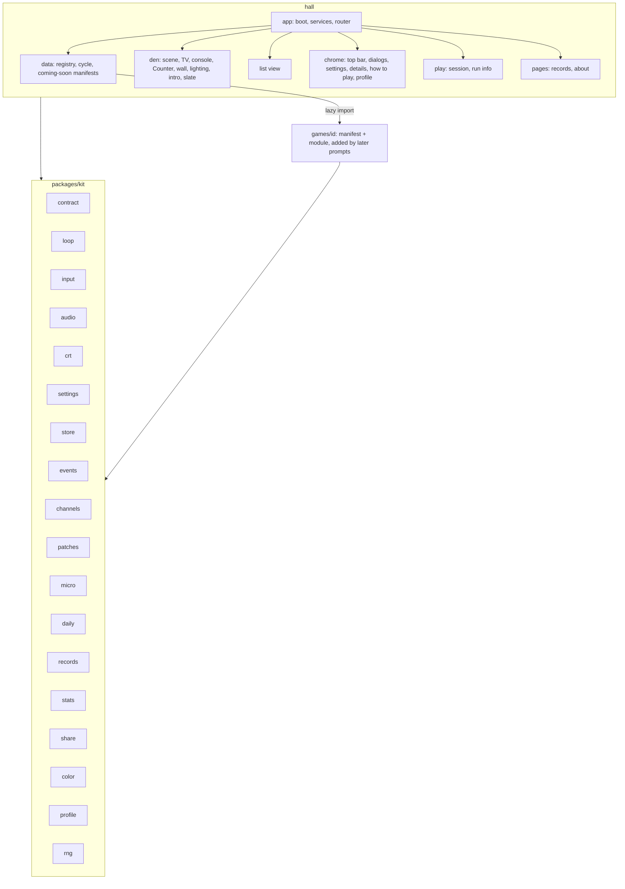
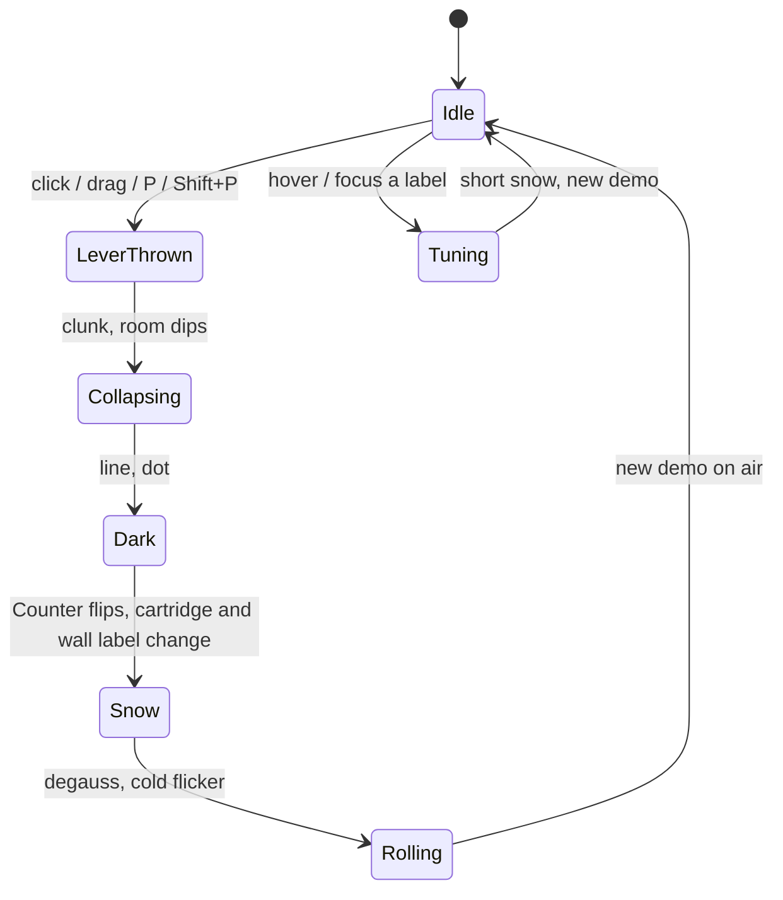

# Architecture

How Woodgrain '88 fits together: the kit every game shares, the Hall's data layer, The Den's scene
and its anchors, routing, the flow of events, channels, patches and micro-challenges, the store, the
crew bridge, and build and deploy. Decisions and their reasons are in `docs/adr/`.

## The kit (`packages/kit/src`)

| Module                   | What it does                                                                                                                              |
| ------------------------ | ----------------------------------------------------------------------------------------------------------------------------------------- |
| `contract.ts`            | `GameManifest`, `GameModule`, `GameContext`, `GameInstance`, `DemoHandle`, `LabelArt`; `validateManifest`, `validateRegistry`             |
| `rng.ts`                 | sfc32 seeded generator: `int`, `float`, `chance`, `pick`, `shuffle`, `fork(label)`; `hashSeed`, `randomSeed`                              |
| `loop.ts`                | Fixed-step loop with interpolation, stall guard, auto-pause option, turn mode, headless `step`                                            |
| `input.ts`               | Two seats over keyboard, gamepads and pointer; per-step edges; bindings with `rebind` and `validateBindings`                              |
| `audio.ts`               | WebAudio synth: sounds as data, glides, noise, an old-console pitch flavour, a small sequencer, channels and `silence()`                  |
| `crt.ts`                 | WebGL CRT: curvature, scanlines, glow, collapse to a dot, warm-up, snow, roll, degauss; 2D fallback; `sampleColor()`                      |
| `settings.ts`            | Settings over the store with live appearance and motion, CRT gating, per-channel volume, per-game namespace                               |
| `store/`                 | `LocalStore` (never throws, memory fallback), repositories, schema with migrations and `sanitize`, export/import, the before-paint script |
| `events.ts`              | Event bus: stamps game, mode, channel and time; delivers on microtasks; session summaries to the event log                                |
| `channels.ts`            | Channel registry with unlock state (all open until prompt 01's rule)                                                                      |
| `patches.ts`             | Patch tracker: count, max and sum goals over events, gold thread on Pro, toasts                                                           |
| `micro.ts`               | 45-second micro-challenge runs judged on events                                                                                           |
| `daily.ts`               | UTC day, daily number (#1 is 2026-10-25), daily seeds, the Power Cycle of the day, share lines                                            |
| `records.ts`, `stats.ts` | Top ten per game, channel and mode; plays, best, time, versus wins                                                                        |
| `share.ts`               | Tamper-evident challenge links in the hash; SVG share cards; copy and download                                                            |
| `color.ts`               | Parsing, mixing, WCAG contrast, `ensureContrast`                                                                                          |
| `profile.ts`             | Display name rules, avatar descriptor                                                                                                     |

## The Hall's data layer (`hall/src/data`)

- `coming-soon/<id>.ts`: thirty manifests, one file each. A game's own prompt moves its manifest to
  `games/<id>/` and gives `BASE_ENTRIES` a `load` function.
- `registry.ts`: `BASE_ENTRIES`, `createRegistry(overrides)` (the harness swaps the fake game into
  slot 20), `wallRows`, `FAMILY_NAMES`.
- `cycle.ts`: the 32 Counter places, `nextSlot` with wrap-around, the two locked secret slots.

## The Den's scene graph and anchors (`hall/src/den`)

The room is one SVG on a 1600×900 core (`geometry.ts` holds every position), drawn by `room.ts`,
`tv.ts`, `console.ts`, `wall.ts`, `label.ts`, `lighting.ts` and assembled in `scene.ts`.
`den-view.ts` lays it out, puts the CRT over the screen and runs the moments.

| Anchor                   | Selector                                         | Used by                                             |
| ------------------------ | ------------------------------------------------ | --------------------------------------------------- |
| TV                       | `[data-ref="tv"]`                                | details                                             |
| POWER / RESET levers     | `[data-ref="power"]`, `[data-ref="reset"]`       | the power switch                                    |
| Difficulty switches      | `[data-ref="switch-1"]`, `[data-ref="switch-2"]` | prompt 01: the Pro switch                           |
| Counter digits and lamps | `[data-ref="counter-digit-0                      | 1"]`, `[data-ref="counter-lamps"] .lamp[data-slot]` | prompt 01: patches light lamps |
| Wall cartridges          | `.cartridge[data-game][data-slot]`               | tuning, details                                     |
| Calendar                 | `[data-ref="calendar"]`, `calendar-month         | day                                                 | daily` text                    | prompt 01: streaks |
| Jacket                   | `[data-ref="jacket"]` with `.patch-places`       | prompt 01: the jacket                               |
| Pads                     | `[data-ref="pads"]`                              | prompt 01: Versus Night                             |
| Focus indicator          | `[data-ref="focus-indicator"]`                   | keyboard focus above the night layer                |

## Routing (`hall/src/routes`, `hall/src/app/boot.ts`)

`#/` The Den · `#/list` Label Wall · `#/game/<id>` game menu (or details for a coming-soon game) ·
`#/play/<id>?mode=daily|challenge&ch=&seed=&beat=&sig=` · `#/records` · `#/about`. Leaving a
running game through any route change asks first when progress would be lost.

## Events, channels, patches and micro-challenges

Channels are curated variations with stable ids; records are keyed by game, channel and mode.
Micro-challenges reuse the patch metrics with a 45-second clock; prompt 01 builds the Power Cycle
Run on them.

## The store

See `docs/adr/0006-store.md`. Seven repositories, versioned envelopes, sanitise on every read and
import, memory fallback, export/import as one JSON file with a preview.

## The crew bridge

See `docs/adr/0007-crew-bridge.md` and `docs/team/PROTOCOL.md`. Orders in `.team/orders/`, a staging
copy per run, fence sorting, acceptance in the real repo, a tracked ledger.

## Build and deploy

- `pnpm build` builds `hall/` with Vite; games are lazy chunks; `BASE_PATH` sets the base path.
- `hall/build/early-appearance.ts` inlines the before-paint script; `hall/build/offline-precache.ts`
  writes `sw.js`, which precaches every built file (offline after the first visit).
- `.github/workflows/ci.yml` runs lint, typecheck, test, check, build and e2e on pushes and pull
  requests; `.github/workflows/pages.yml` builds with `BASE_PATH=/woodgrain-88/` and deploys to
  GitHub Pages.
