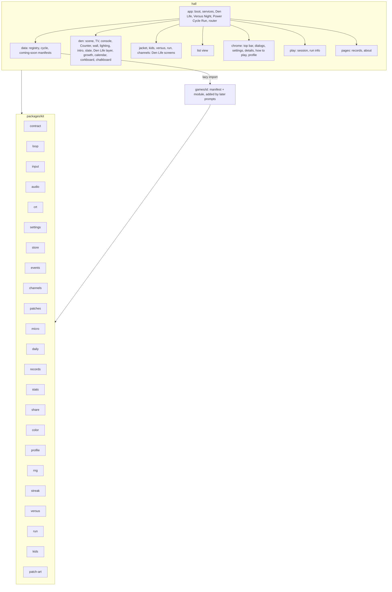
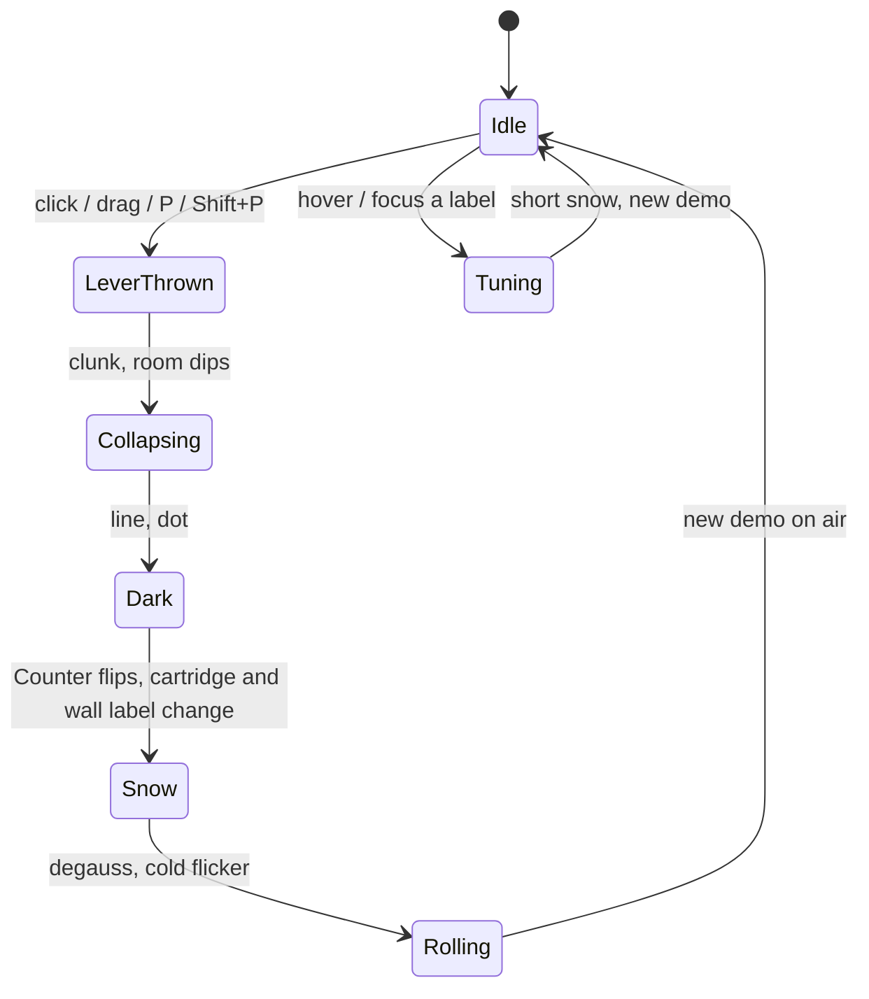
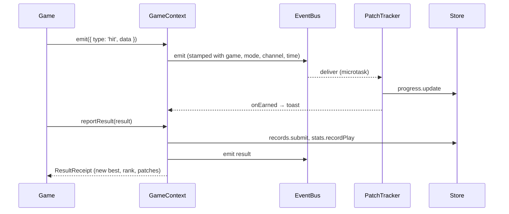
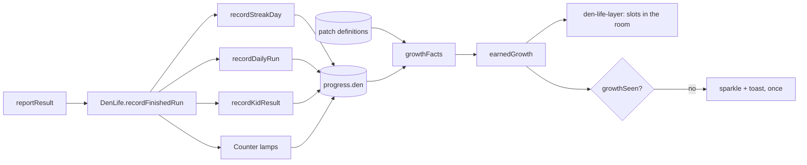
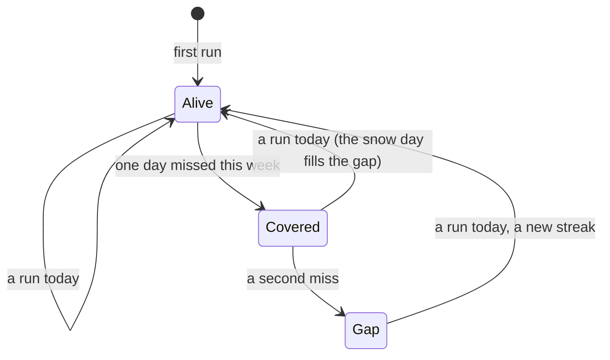
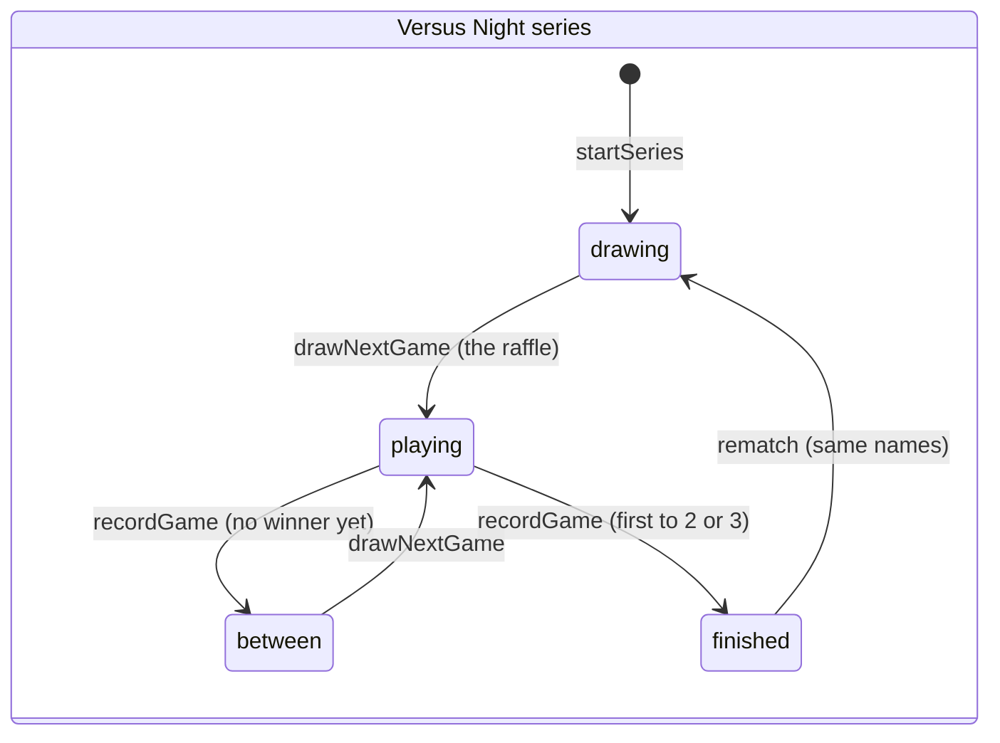
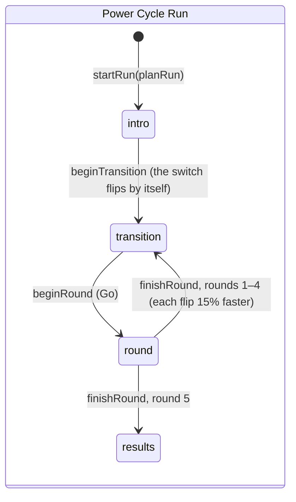

# Architecture

How Woodgrain '88 fits together: the kit every game shares, the Hall's data layer, The Den's scene
and its anchors, routing, the flow of events, channels, patches and micro-challenges, Den Life
(streaks, Versus Night, the Power Cycle Run, growth), the store, the crew bridge, and build and
deploy. Decisions and their reasons are in `docs/adr/`.

## The kit (`packages/kit/src`)

| Module                   | What it does                                                                                                                              |
| ------------------------ | ----------------------------------------------------------------------------------------------------------------------------------------- |
| `contract.ts`            | `GameManifest`, `GameModule`, `GameContext`, `GameInstance`, `DemoHandle`, `LabelArt`; `validateManifest`, `validateRegistry`             |
| `rng.ts`                 | sfc32 seeded generator: `int`, `float`, `chance`, `pick`, `shuffle`, `fork(label)`; `hashSeed`, `randomSeed`                              |
| `loop.ts`                | Fixed-step loop with interpolation, stall guard, auto-pause option, turn mode, headless `step`                                            |
| `input.ts`               | Two seats over keyboard, gamepads and pointer; per-step edges; bindings with `rebind` and `validateBindings`                              |
| `audio.ts`               | WebAudio synth: sounds as data, glides, noise, an old-console pitch flavour, a small sequencer, channels and `silence()`                  |
| `crt.ts`                 | WebGL CRT: curvature, scanlines, glow, collapse to a dot, warm-up, snow, roll, degauss; 2D fallback; `sampleColor()`                      |
| `settings.ts`            | Settings over the store with live appearance and motion, CRT gating, per-channel volume, per-game namespace                               |
| `store/`                 | `LocalStore` (never throws, memory fallback), repositories, schema with migrations and `sanitize`, export/import, the before-paint script |
| `events.ts`              | Event bus: stamps game, mode, channel and time; delivers on microtasks; session summaries to the event log                                |
| `channels.ts`            | Channel kinds (original, remix), groups, `originalGame`, `MAX_CHANNELS` 64, unlock rule (originals open, Remix by patch), `channelNumber` |
| `patches.ts`             | Patch tracker: count, max and sum goals over events, gold thread when the seat's switch is on A, toasts                                   |
| `patch-art.ts`           | One embroidery generator for every patch: tier shapes, twill, merrow border, satin emblem, gold thread                                    |
| `streak.ts`              | Days played, one snow day per ISO week, `streakView`, `calendarMonth`                                                                     |
| `versus.ts`              | Versus Night series state machine, raffle draws, rematch, rivalries                                                                       |
| `run.ts`                 | Power Cycle Run: plan, state machine, scoring, transition timing, share line, records                                                     |
| `kids.ts`                | The six Neighbourhood Kids, their personalities, `aiSettings`, the Block Ladder                                                           |
| `micro.ts`               | 45-second micro-challenge runs judged on events                                                                                           |
| `daily.ts`               | UTC day, daily number (#1 is 2026-10-25), daily seeds, the Power Cycle of the day and its channel, first run of the day, share lines      |
| `records.ts`, `stats.ts` | Top ten per game, channel and mode; plays, best, time, versus wins                                                                        |
| `share.ts`               | Tamper-evident challenge links in the hash; SVG share cards; copy and download; `emojiSummary` (at most 12)                               |
| `color.ts`               | Parsing, mixing, WCAG contrast, `ensureContrast`                                                                                          |
| `profile.ts`             | Display name rules, avatar descriptor                                                                                                     |
| `versions.ts`            | Cartridge versions of a merged game: `VERSION_SETTING`, `defaultVersion`, `alternateVersions`, `findVersion`, `resolveVersion`            |

## The Hall's data layer (`hall/src/data`)

- `coming-soon/<id>.ts`: thirty manifests, one file each. A game's own prompt moves its manifest to
  `games/<id>/` and gives `BASE_ENTRIES` a `load` function.
- `registry.ts`: `BASE_ENTRIES`, `createRegistry(overrides)` (the harness swaps the fake game into
  slot 11, so its second version owns Counter place 31), `wallRows`, `FAMILY_NAMES`.
- `cycle.ts`: the 32 Counter places (`counterPlaces`: games 1–30 in their default versions, 31 and
  32 the merged games' other versions), `placeFinished` for the lamps, `nextSlot` with wrap-around.

## The Den's scene graph and anchors (`hall/src/den`)

The room is one SVG on a 1600×900 core (`geometry.ts` holds every position), drawn by `room.ts`,
`tv.ts`, `console.ts`, `wall.ts`, `label.ts`, `lighting.ts` and assembled in `scene.ts`.
`den-view.ts` lays it out, puts the CRT over the screen and runs the moments.

| Anchor                   | Selector                                                                                                                                                                    | Used by                                                                    |
| ------------------------ | --------------------------------------------------------------------------------------------------------------------------------------------------------------------------- | -------------------------------------------------------------------------- |
| TV                       | `[data-ref="tv"]`                                                                                                                                                           | details                                                                    |
| POWER / RESET levers     | `[data-ref="power"]`, `[data-ref="reset"]`                                                                                                                                  | the power switch                                                           |
| Difficulty switches      | `[data-ref="switch-left"]`, `[data-ref="switch-right"]` (class `is-a` on A)                                                                                                 | the per-seat switches; `[` and `]`                                         |
| Counter digits and lamps | `[data-ref="counter-digit-0"]`, `[data-ref="counter-digit-1"]`, `[data-ref="counter-lamps"] .lamp[data-slot]`, hover cells `.lamp-hit[data-slot]`                           | prompt 01: patches light lamps; 31 and 32 are the other cartridge versions |
| Wall cartridges          | `.cartridge[data-game][data-slot]`                                                                                                                                          | tuning, details                                                            |
| Calendar                 | `[data-ref="calendar"]`; `calendar-month`, `calendar-day`, `calendar-grid`, `calendar-streak`, `calendar-daily`                                                             | streaks, the month view                                                    |
| Jacket                   | `[data-ref="jacket"]` with `jacket-patches` and `.jacket-glint` (`has-news`)                                                                                                | the Jacket screen                                                          |
| Corkboard                | `[data-ref="corkboard"]` over `[data-ref="corkboard-art"]`                                                                                                                  | the Kids screen                                                            |
| Chalkboard and pads      | `[data-ref="chalkboard"]` over `[data-ref="chalkboard-art"]`, `[data-ref="pads"]`                                                                                           | Versus Night                                                               |
| Growth slots             | `[data-growth-slot="posters" \| "paper-chain" \| "on-air" \| "remote" \| "plaque" \| "string-lights" \| "trophies" \| "second-beanbag" \| "glow"]`, `[data-ref="cat-slot"]` | what the room has grown                                                    |
| Power hold ring          | `[data-ref="power-hold-ring"]`                                                                                                                                              | holding POWER starts a run                                                 |
| Focus indicator          | `[data-ref="focus-indicator"]`                                                                                                                                              | keyboard focus above the night layer                                       |

## Routing (`hall/src/routes`, `hall/src/app/boot.ts`)

`#/` The Den · `#/list` Label Wall · `#/game/<id>` game menu (or details for a coming-soon game) ·
`#/play/<id>?mode=daily|challenge|power-cycle-run|versus-night&ch=&seed=&beat=&sig=&micro=` ·
`#/records` · `#/about` · `#/jacket` · `#/kids` · `#/versus` · `#/run` (the Den with the run's
overlay). Leaving a running game through any route change asks first when progress would be lost;
a finished run round goes back to `#/run` without asking.

## Events, channels, patches and micro-challenges

Channels are curated variations with stable ids; records are keyed by game, channel and mode.
Micro-challenges reuse the patch metrics with a 45-second clock; prompt 01 builds the Power Cycle
Run on them.

## Den Life

Den Life is the layer over all the games (ADR-0008). The rules are pure kit functions; the Hall's
`DenLife` service (`hall/src/app/den-life.ts`) folds every finished run into all of them at once,
and `den-life-layer.ts` draws the results into the room. A Versus Night series and a Power Cycle
Run live in memory (`versus-night.ts`, `power-run.ts`) while they pass through several screens;
only finished ones are stored.

The streak counts days with any finished run; one snow day per ISO week covers a single gap.

The run's flip is the Den's own power switch played automatically (`DenView.runFlip`): the room
dims, the picture collapses, the next cartridge drops into the slot, the Counter flips, snow, and
the goal card drops into the game card's corner. A round in a game is `play/den-modes.ts`: the
goal and a clock that stops while paused, judged by the kit's `startMicro` on the game's events.

## The store

See `docs/adr/0006-store.md`. Seven repositories, versioned envelopes, sanitise on every read and
import, memory fallback, export/import as one JSON file with a preview. Settings are at v2 (the
switches and the Den Life settings) and progress at v3 (`progress.den`, ADR-0008).

## The crew bridge

See `docs/adr/0007-crew-bridge.md` and `docs/team/PROTOCOL.md`. Orders in `.team/orders/`, a staging
copy per run, fence sorting, acceptance in the real repo, a tracked ledger.

## Build and deploy

- `pnpm build` builds `hall/` with Vite; games are lazy chunks; `BASE_PATH` sets the base path.
  The dev showcase (`hall/src/dev/`) and the test fixtures never reach the build; `pnpm check`
  fails if a trace of either does.
- `hall/build/early-appearance.ts` inlines the before-paint script; `hall/build/offline-precache.ts`
  writes `sw.js`, which precaches every built file (offline after the first visit).
- `.github/workflows/ci.yml` runs lint, typecheck, test, check, build and e2e on pushes and pull
  requests; `.github/workflows/pages.yml` builds with `BASE_PATH=/woodgrain-88/` and deploys to
  GitHub Pages.
