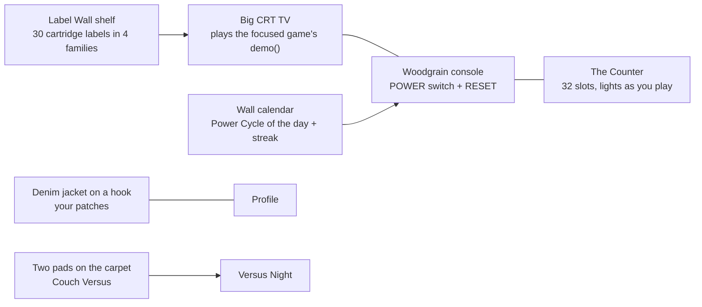
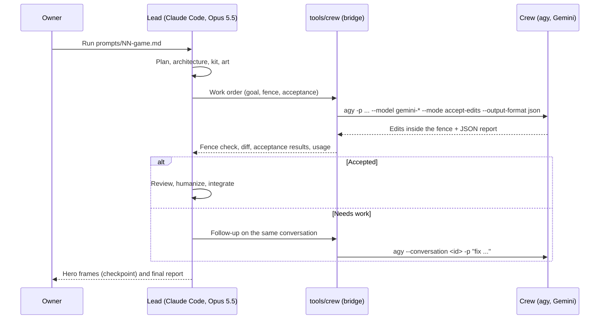
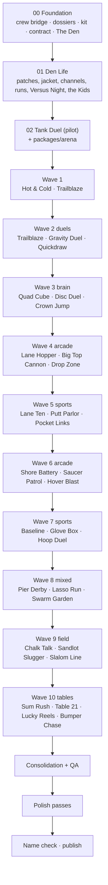

# Woodgrain '88 — collection plan

> Architect's plan, owned by the architect and the owner. Builders read it for context; prompts win
> over this file where they differ. Titles marked *prov.* are provisional until each game's brief
> and a name check.

## 1. The hook

In 1988 Atari released a cartridge for Europe and other non-US markets that claimed **32 games in
1**. It had no menu: a different game loaded every time the console was switched on, so finding
the one you wanted meant flipping the power switch again and again. (Source: Centre for Computing
History. The exact mechanism, and whether Reset plays any part, is to be verified in the master
disassembly `src/32_in_1_cartridge.asm`.)

And it was not quite 32. A byte-level comparison of the extracted 2 KB games shows two pairs that
are the same program with a few bytes changed:

| Pair | Bytes that differ (of 2,048) | What it probably is (to verify in the dossiers) |
|---|---|---|
| `11_Freeway_Rabbit` vs `19_Freeway_Chicken` | 59 | Same road-crossing game, different hero sprite |
| `15_Fishing` vs `26_Fishing_Derby` | 45 | Same fishing game, small cosmetic or rule changes |

For contrast, two unrelated games (`07_Golf` vs `12_Miniature_Golf`) differ in 2,018 bytes.

So the honest count is **30 games**. Woodgrain '88 makes both facts part of the experience: the Hall
is driven by a **power switch** you flip to cycle through the collection, and the counter goes to
32 because the two "padding" games come back as **cartridge versions** you can pick in their real games
(finding them lights slots 31 and 32).

## 2. Curation — 30 games

`Family` drives which shared package a game uses (§6). `Flags` marks things the owner must decide.
Original titles are as labelled in the disassembly manifest and must be verified (rule: trust the
code, not the labels).

| # | Source | Labelled original | Family | Title *(prov.)* | Reborn idea in one line | Flags |
|---|---|---|---|---|---|---|
| 1 | `01_UFO` | Space Jockey | Arcade | Saucer Patrol | Side-on sky defence where waves can be learned, not just survived | |
| 2 | `02_Human_Cannonball` | Human Cannonball | Arcade | Big Top Cannon | Physics cannon with an arc you learn to read; a circus that grows with every landing | |
| 3 | `03_Fun_with_Numbers` | Basic Math | Brain | Sum Rush | Speed-math arcade with a gentle ladder for kids and a brutal daily for adults | |
| 4 | `04_3D_Tic_Tac_Toe` | 3-D Tic-Tac-Toe | Brain | Quad Cube | 4×4×4 on a rotatable glass cube with every winning line lit on hover | |
| 5 | `05_Flag_Capture` | Flag Capture | Brain | Hot & Cold | Hidden-flag deduction where every clue paints the board; a 2P race version | |
| 6 | `06_Reversi` | Othello | Brain | Disc Duel | Disc-flipping with flip previews and rival bots with real styles | Trademark: never "Othello" |
| 7 | `07_Golf` | Golf | Sports | Pocket Links | Nine generated holes, wind and lie you can read, a satisfying three-click swing | |
| 8 | `08_Surround` | Surround | Duels | Trailblaze | Light-trail duel in a living arena; power-ups only in a Remix channel | |
| 9 | `09_Checkers` | Checkers | Brain | Crown Jump | Checkers with capture hints and multi-jump chains dragged in one gesture | |
| 10 | `10_Blackjack` | Blackjack | Brain | Table 21 | Classic casino blackjack with chips and bets; an optional strategy coach | |
| 11 | `11_Freeway_Rabbit` + `19_Freeway_Chicken` | Freeway (+ reskin) | Arcade | Lane Hopper | Road-crossing race against a friend or a bot; hero chosen in Settings: chicken (slot 19) or rabbit (slot 11) | Merge |
| 12 | `12_Miniature_Golf` | Miniature Golf | Sports | Putt Parlor | Toy-box mini golf with moving obstacles we design ourselves | |
| 13 | `13_Football` | Football | Sports | Chalk Talk | Pocket football where you call plays on a chalkboard and watch them run | No league names |
| 14 | `14_Slot_Racers` | Slot Racers | Duels | Bumper Chase | Maze-car duel with missiles; arenas are ours | |
| 15 | `15_Fishing` + `26_Fishing_Derby` | Fishing Derby (+ hack) | Sports | Pier Derby | Two anglers, one pier, a hungry shark to dodge; cartridge version chosen in Settings: slot 26 or slot 15 | Merge |
| 16 | `16_Space_War` | Space War | Duels | Gravity Duel | Two ships around a star with real gravity; orbits drawn as you learn them | |
| 17 | `17_Boxing` | Boxing | Duels | Glove Box | Top-down boxing scored on clean punches, knockouts included | |
| 18 | `18_Air_Sea_Battle` | Air-Sea Battle | Arcade | Shore Battery | Anti-aircraft and naval gunnery duel: planes overhead, ships below | |
| 19 | `20_Tennis` | Tennis | Sports | Baseline | Two-button tennis where angle comes from timing; doubles vs bots | |
| 20 | `21_Combat` | Combat | Duels | Tank Duel | Tanks, jets and biplanes in a living arena; ricochets, cover, explosions; couch versus first | |
| 21 | `22_Slot_Machine` | Slot Machine | Brain | Lucky Reels | A real slot machine with credits, paylines and a bankroll; play money only | |
| 22 | `23_Skiing` | Skiing | Sports | Slalom Line | Downhill and slalom on generated mountains; ghost runs of your best | |
| 23 | `24_Stampede` | Stampede | Arcade | Lasso Run | Ranch round-up rhythm game; rope the herd before it escapes | |
| 24 | `25_Outlaw` | Outlaw | Duels | Quickdraw | Western gunfight with six-shooters, cover and ricochets | |
| 25 | `27_Sky_Diver` | Sky Diver | Arcade | Drop Zone | Wind-reading skydiving onto a moving target; crash-landings and all | |
| 26 | `28_Laser_Blast` | Laser Blast | Arcade | Hover Blast | Hover-craft duel against ground drones in a neon canyon | |
| 27 | `29_Basketball` | Basketball | Sports | Hoop Duel | One-on-one street court; dribble, fake, a shot arc you can feel | |
| 28 | `30_Ant_Party` | Cosmic Swarm (hack) | Arcade | Swarm Garden | Shepherd a swarm away from the picnic before it builds a nest | |
| 29 | `31_Bowling` | Bowling | Sports | Lane Ten | Ten-pin with spin you steer after release, pin physics worth watching | |
| 30 | `32_Home_Run` | Home Run | Sports | Sandlot Slugger | Backyard baseball with pitch types and a batting eye you train | No league names |

## 3. Owner decisions (2026-10-26)

1. **Collection title:** "Woodgrain '88". A full name check runs before publication.
2. **Merges:** the Freeway pair and the Fishing pair each become one game, with a Settings option
   to choose which cartridge version to play (hero skin, and for the fishing pair the slot-15
   variant with its own graphics and swapped difficulty switches). Playing each version lights its
   own Counter lamp, so the Counter still reaches 32.
3. **Faithful themes:** no softened reframes. Combat keeps tanks and explosions, Outlaw keeps
   six-shooters, Air-Sea Battle keeps planes and ships, Boxing keeps knockouts, Sky Diver and Human
   Cannonball keep their crashes. Arcade presentation, no gore.
4. **Slot Machine stays a slot machine** (credits, bets, paylines), play money only.
5. **Blackjack keeps chips and bets**, as the game is played; the strategy coach is optional.
6. Titles stay provisional until each game's brief; five were renamed today to match decisions
   3–5 (Tank Duel, Quickdraw, Shore Battery, Lucky Reels, Big Top Cannon).

## 4. The Hall — "The Den"

A wood-panelled rec room in 1988, drawn entirely in code, 2.5D, filling 1280×720 to 2560×1440.

- **The power switch is the signature moment.** Flip it (click, drag the lever, or press `P`): the
  room light dips, the CRT collapses to a dot, snow, a degauss wobble, and the TV lands on the next
  game's live demo while the Counter clicks forward. Shift goes backwards. Reduced motion: a short
  cross-fade.
- **The Label Wall** is the precise way in: 30 code-drawn cartridge labels on a shelf in four rows
  (Duels, Brain, Sports, Arcade). Hover or focus a label and the TV switches channel to that game.
- **Light** is a sunny afternoon through venetian blinds; **dark** is late evening, a desk lamp and
  the TV as the main light, the room tinted by whatever the screen shows.
- **List view** (`#/list`): the same labels as an accessible grid; default below 900 px.
- **Intro** (first visit, ≤ 5 s, skippable): the room is dark, the switch clicks, the CRT warms up
  and the snow resolves into the logo.

## 5. Gamification — "Den Life"

Everything is earned by playing, shown upfront, and finishable. Nothing is bought.

| System | What it is | Why players come back |
|---|---|---|
| **Power Cycle of the day** | Each UTC day the Counter lands on one game with a seeded daily channel; one emoji share line | A shared daily moment |
| **Forgiving streak** | Calendar ticks; one automatic "snow day" per week; a missed day leaves a gap, never a reset message | Habit without guilt |
| **Patches** | Every game has Club / Pro / Legend patches with published thresholds, plus one secret | Clear goals per game |
| **The Jacket** | Patches are sewn onto a denim jacket you arrange by drag and drop; export as an SVG card | A collection that shows taste |
| **Difficulty switches** | The console's two switches, left for seat 1 and right for seat 2, A hard and B easy as on the original; each game says what A means; patches earned on A are sewn in gold thread | Mastery |
| **Channels** | Every variation of the original program is a channel, open from the first play ("Game 1–27"); Remix channels are earned with a patch; tuned on a TV dial with a number pad | Variety without menus of numbers |
| **Power Cycle Run** | Meta-mode: five random games, 45 seconds each, one micro-goal each; daily seeded run | The thread that ties 30 games together |
| **Versus Night** | Two players on one machine, best of three across random duel games; bots fill a missing seat | Couch play, the soul of the console |
| **The Neighbourhood Kids** | One cast of bot rivals shared by every game (aggressive Dee, careful Moss, chaotic Pip, slow-but-perfect Grandpa Lou, ...) with code-drawn avatars | Personality across the collection |
| **The Counter** | 32 slots: 30 light as you earn a first patch, 31-32 light when you play the two alternate cartridge versions | Completion with a story |

Prompt 00 builds the hooks (events, channels, micro-challenges, store, patches registry). Prompt 01
builds Den Life itself.

## 6. The team — Opus leads, Gemini builds

Each Claude Code session (Opus 5.5) is a **lead**: it reads the prompt, designs the code
architecture, owns the kit, rendering, art, the signature moment, game feel and every hero frame,
and reviews and integrates everything. It hands routine work to a **crew** of Gemini models through
the Antigravity CLI (`agy`, headless print mode, JSON output, resumable conversations), so the owner
never relays anything.

| Lead (Opus 5.5) | Crew (Gemini via `agy`) |
|---|---|
| Architecture, ADRs, contracts | Rules engines to a lead-written interface and test list |
| Kit and shared packages | Bots, simulations and balance sweeps |
| Rendering, art direction, animation, signature moments | Unit and e2e tests, fixtures |
| Game feel, audio design | Docs drafts (HOW-TO-PLAY, NOTES tables), manifests, achievement data |
| Hero frames and critique loops | Accessibility labels, keyboard maps, settings plumbing |
| Review of every crew diff, final integration | Behaviour dossiers from the disassembly (`research/dossiers/`) |

Verified on the owner's machine on 2026-10-25: `agy` 1.4.7 runs headless (`-p`, `--output-format
json`), edits files in accept-edits mode and returns a `conversation_id` for follow-ups; Gemini 4
Argon and Gemini 3.8 Flash are available. Rules: always pin a Gemini model; never skip permissions;
one write fence per order; every crew diff reviewed; usage logged in `.team/LEDGER.md` so the owner
can see the savings.

## 7. Roadmap

Every game gets a brief in chat first (hook from its dossier, design, screens, light/dark identity),
then its prompt. Waves run 2–3 Claude Code sessions in parallel, each with its own crew; exactly one
session per wave owns the kit.
