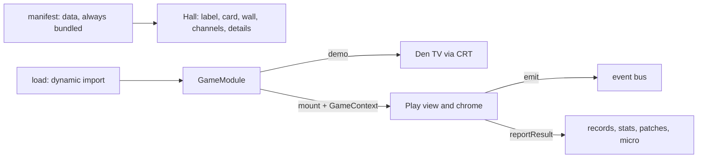

# ADR-0002 — The game contract

- Status: accepted
- Date: 2026-10-25
- Code: `packages/kit/src/contract.ts`

## Context

Thirty very different games (turn-based boards, twitch duels, physics sports) plug into one Hall,
built by different sessions over many waves. The Hall must draw every game's label, card and
channels without loading its code, show a live demo on the TV, run it with the same chrome, and
collect results, records, patches and micro-challenge outcomes the same way for all of them.

## Decision

A game is two things:

1. A **manifest** (`GameManifest`): plain data bundled with the Hall. Id, slot, title, tagline,
   teaser, family, players and versus, session length, status, score order, accent (day and night),
   emblem, label art, `inspiredBy` (the only home of the original's name), controls, channels,
   supported features, event schemas, and (since the 2026-10-26 amendment below) cartridge
   versions for a merged game. A coming-soon game is a manifest without a module.
2. A **module** (`GameModule`), imported only when opened: `mount(host, context)` returns a
   `GameInstance` (`pause`, `resume`, `gameMenu`, `playAgain`, `leaveCheck`, `dispose`);
   `demo(host, seed, context)` returns a `DemoHandle` for the Den's TV (its own canvas, silent,
   looping, appearance-aware, pausable); plus patches, micro-challenges and a How to play card.

Everything a running game needs arrives through `GameContext`: the run (mode, seed, channel,
daily number, micro brief, challenge), a seeded RNG, two-seat input, audio, settings (appearance,
motion, shake, CRT, colour-blind hints, a per-game namespace), the Pro switch (reported, rules in
prompt 01), a versioned save slot, patch status, records, `createLoop` (loops the chrome pauses),
`emit`, `reportResult`, sharing, `setView`, `setPauseItems`, `requestPause`, `openSettings`,
`openHowToPlay`, `backToHall`, `forgetGameData`.

Refinements to the starting sketch, and why:

- `scoreOrder` in the manifest: golf strokes and ski times are better when lower; records need to
  know without loading code.
- `playAgain()` on the instance: the Hall-presented results screen has Play again (R) and Rematch,
  which only the game can do.
- `reportResult` returns a `ResultReceipt` (new best, rank, patches earned, micro result), so a game
  that presents its own results shows the same facts the Hall would.
- `SaveSlot.load` returns `unknown`: stored data is untrusted; the game validates its own format.
- `createLoop` is on the context so the chrome can pause every loop together with the game.

## Consequences

- Renaming a game is a one-file change (its manifest); ids, slots and channel ids are stable.
- The Hall validates the whole registry at test time (`validateRegistry`): unique ids and slots,
  AA contrast on every label band, channel and event schemas.
- A game never touches storage, the URL or the document outside its host element.

## Amendment, 2026-10-26 (prompt 00a): cartridge versions instead of secrets

The owner decided that the two near-duplicate programs on the cartridge are not hidden extras to
find but versions to choose. The manifest's `secrets` field is gone; a merged game declares
`versions: CartridgeVersion[]` (`id`, `label`, `cartridgeSlot`, `description`), at least two,
the first being the default. Lane Hopper has `chicken` (cartridge program 19) and `rabbit` (11);
Pier Derby has `derby` (26) and `hack` (15).

- **Choosing.** The player picks a version on the game's details overlay or in its settings. The
  choice is saved in the game's settings namespace under `VERSION_SETTING` (`cartridgeVersion`).
- **Passing.** The Hall resolves one version per run and hands it to the game as `run.version`
  (`resolveVersion`): the challenge's version, else the one the route asks for, else the saved
  choice, else the default. Demos receive `DemoContext.version`. A challenge link signs its
  version into the checksum, so a friend plays the version the score was set on; links without a
  version still verify.
- **The Counter.** Places 1–30 are the games in their default versions; 31 and 32 are the other
  versions of the merged games, in slot order, and tuning there opens the game in that version.
  A version's lamp lights the first time a run is finished with it (`progress.versionsFinished`,
  progress schema v2; the v1 migration drops the never-written `secretsFound`). The locked
  "something is hidden" channel is gone.
- **Validation.** `validateManifest` checks the versions (two or more, kebab-case and unique ids,
  label and description lengths, each `cartridgeSlot` one of `inspiredBy.cartridgeSlots` and used
  once); `validateRegistry` checks that no cartridge slot belongs to two games' versions.
