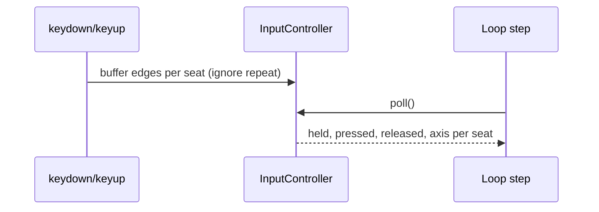

# ADR-0003 — Loop, input and two seats

- Status: accepted
- Date: 2026-10-25
- Code: `packages/kit/src/loop.ts`, `packages/kit/src/input.ts`

## Context

The cartridge's soul is two people on one couch. Games must feel identical on a 60 Hz laptop and a
144 Hz monitor, replay exactly from a seed, and accept two players on one keyboard or two gamepads.

## Decision

**Loop.** A fixed-timestep simulation (60 Hz unless a game asks otherwise) with an accumulator and
render interpolation. A stall guard caps one display frame at 0.25 s of simulation and counts
stalls. A tiny tolerance (one microsecond) stops floating-point frame times from producing a frame
with no update followed by one with two; the crew's tests found that drift. `resume()` discards
paused time. A turn mode ticks nothing and draws only on `invalidate()`. `step(n)` runs the same
loop headless for tests and bots. Loops created through the context are paused by the chrome.

**Input.** Games ask for actions, never keys. Two seats:

| Seat | Keyboard (split layout)                   | Gamepad    |
| ---- | ----------------------------------------- | ---------- |
| 1    | Arrows + Enter (fire) + L (second button) | first pad  |
| 2    | WASD + Space (fire) + F (second button)   | second pad |

In the solo layout seat 1 answers to both halves and every pad. (Amended 2026-10-27, prompt 02:
the seats were the other way round, and the layout was a setting.) Presses are buffered between steps,
so a tap that starts and ends between two ticks still arrives as `pressed` and `released`. OS key
repeat is ignored. Escape (and gamepad Start) is reserved for pause and never bindable. Bindings are
data (`Bindings`), with `validateBindings` (no reserved keys, no key shared between seats in split
layout) and `rebind`; the settings panel edits them.

## Consequences

- Bots and simulations call `step` with scripted input; balance targets become regression tests.
- Couch versus works with one keyboard, two pads, or one of each.

## Amendment, 2026-10-27 (prompt 02): the arrows for one player, and no layout setting

The owner's rule: playing alone, the arrow keys; two players on one keyboard, player 1 keeps the
arrows and player 2 takes WASD. The default seats swapped to match. The keyboard layout is no
longer a setting a player has to find. The Hall starts a session solo unless two people play, and
a game whose own menu switches between one and two players calls `input.setLayout` for each match.
The settings panel still checks rebound keys as split, so they work for two players.
