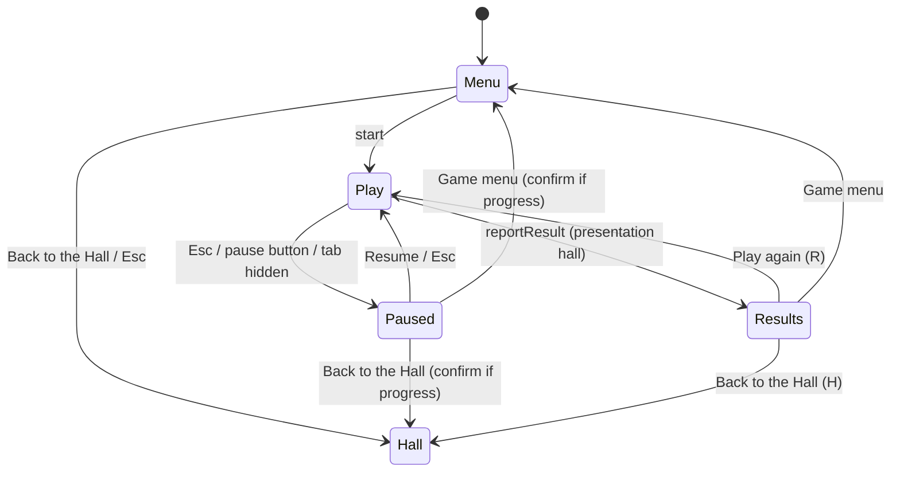

# ADR-0005 — Navigation standard and shared chrome

- Status: accepted
- Date: 2026-10-25
- Code: `hall/src/play/session.ts`, `hall/src/chrome/`

## Decision

Two destinations with fixed names everywhere: **Game menu** and **Back to the Hall**.

| Where                    | What the player sees                                                                                                                                                                        |
| ------------------------ | ------------------------------------------------------------------------------------------------------------------------------------------------------------------------------------------- |
| Game menu (title screen) | "← Back to the Hall" top left; Escape does the same                                                                                                                                         |
| During play              | A pause button with an "Esc" hint; first time only, a hint "Esc — pause and menu"                                                                                                           |
| Pause menu               | Resume · game items · How to play · Settings · Game menu · Back to the Hall                                                                                                                 |
| Results (Hall-presented) | New best ribbon, score, details, patches earned, Challenge a friend, Share card, then Play again (R) · Game menu · Back to the Hall (H); in versus a winner banner per seat and Rematch (R) |
| Leaving mid-game         | A confirmation only when `leaveCheck()` says progress would be lost, including through the browser's Back button                                                                            |

The top bar (hidden during play) holds the logo, the profile chip, today's Power Cycle, Records and
About links, the Den / List switch, the day/night button, sound and settings.

Settings: appearance (Day / Night / Follow my system), sound and volumes, room sound, reduced
motion, screen shake, CRT look, colour-blind hints, controls for both seats (layout, rebinding,
gamepads), show the intro again, export / import with a preview, forget my data.

Every overlay is the same accessible dialog: labelled, focus-trapped, Escape to close where
allowed, focus returned to what opened it, the page behind made inert.

## Consequences

Every game gets the same pause, results and leaving behaviour for free and only adds its own pause
items. The fake game in `hall/tests/fixtures/` exercises the whole loop through the real chrome.
