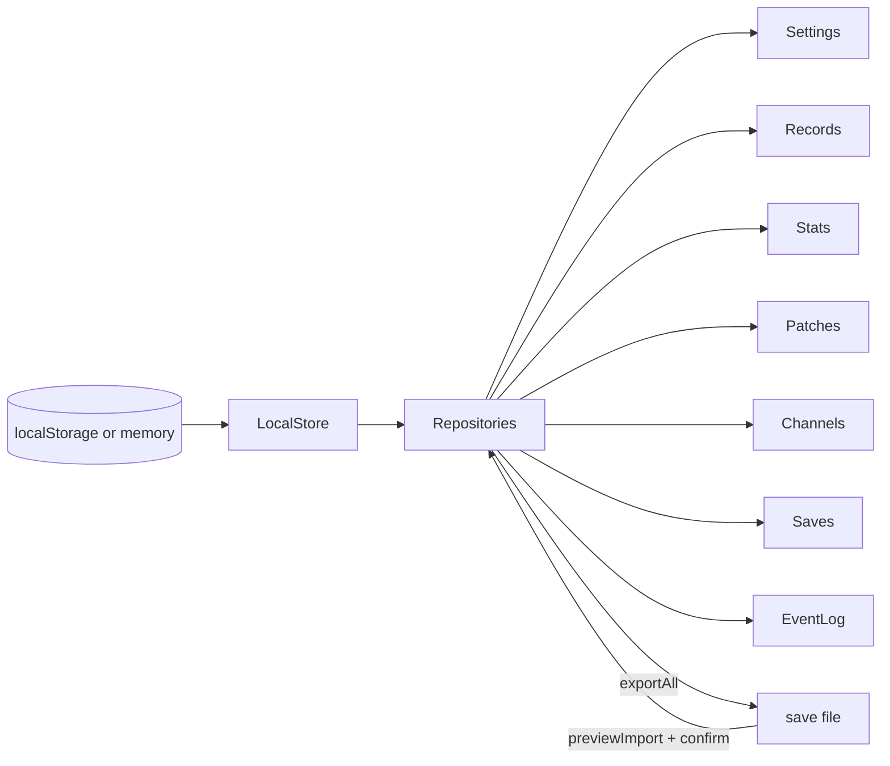

# ADR-0006 — The store

- Status: accepted
- Date: 2026-10-25
- Code: `packages/kit/src/store/`

## Context

All player data lives in the browser (CLAUDE.md rule 13). Thirty games and the Den Life layer will
read and write it for years, so the format must migrate cleanly, survive private mode and full
storage, and be portable without a server.

## Decision

- **One door.** Only `packages/kit/src/store/` touches `localStorage`; `pnpm check` fails any other
  use in shipped code. The before-paint appearance script lives there too for the same reason.
- **Repositories** over one adapter: `profile`, `settings`, `progress` (patches, channel unlocks,
  cartridge versions finished; schema v2 since prompt 00a), `records` (top ten per game, channel and mode), `stats`, `saves` (one versioned
  slot per game), `event-log` (session summaries, newest 200). Each is one JSON document under
  `wg88:<name>` wrapped as `{ "v": version, "data": … }`.
- **Read path**: parse → upgrade through `MIGRATIONS` one version at a time → `sanitize` into the
  exact shape (defaults for missing or wrong fields, unknown keys dropped, numbers clamped) → cache.
  A document from a newer version is left untouched and the defaults are used.
- **Never crash.** If storage is unavailable or a write throws (quota), the store switches to memory
  for the session and reports `persistent: false`; Settings says so once.
- **Export / import**: one validated JSON bundle (`app`, `format`, `exportedAt`, every repository in
  its envelope). Import refuses files over 2 MB, non-JSON, other apps and newer formats with a short,
  kind reason; it sanitises every repository, drops broken ones, shows a summary (name, runs, games,
  patches, sessions) and applies only after the player confirms.

## Consequences

Adding a field means bumping a repository's version and adding one migration; `sanitize` makes old
or hand-edited data safe to read. A later backend could sit behind the same repository interface.
