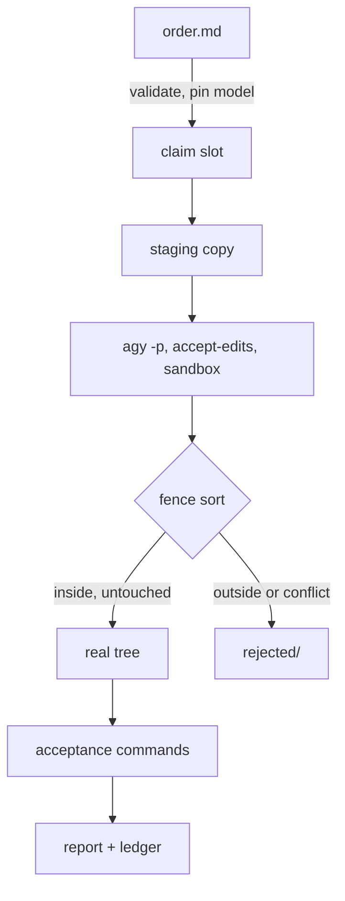

# ADR-0007 — The crew bridge

- Status: accepted
- Date: 2026-10-25, updated 2026-10-26 and 2026-10-27 (amendment below)
- Code: `tools/crew/`; protocol in `docs/team/PROTOCOL.md`, crew rules in `docs/team/CREW.md`

## Context

The owner wants each Claude Code session to be the brain (architecture, visuals, game feel, review)
and Gemini models to do routine coding, to save Claude tokens, without relaying messages by hand.
The Antigravity CLI (`agy` 1.4.7) runs headless with JSON output and resumable conversations.

## What we verified on this machine

| Question                                                   | Finding                                                                                                                                                                                                                                                                      |
| ---------------------------------------------------------- | ---------------------------------------------------------------------------------------------------------------------------------------------------------------------------------------------------------------------------------------------------------------------------- |
| Can the crew edit files in `--mode accept-edits` headless? | Yes.                                                                                                                                                                                                                                                                         |
| Can it run shell commands (tests) in that mode?            | **No.** Every command is soft-denied, recorded in `denied_actions`, and the turn ends at once with an empty reply. A project `.agents/settings.json` allow-rule did not change this; the global settings file or `--dangerously-skip-permissions` would, and we use neither. |
| Does `--sandbox` work?                                     | Yes, with file edits; kept on.                                                                                                                                                                                                                                               |
| Are `usage` and `duration_seconds` per round?              | **No, cumulative per conversation.** The bridge subtracts the previous round's totals and uses its own wall clock.                                                                                                                                                           |
| Is `--print-timeout` enforced?                             | Not reliably. The bridge kills the process 60 s after it.                                                                                                                                                                                                                    |
| Is quota global?                                           | **Per model family.** Gemini 4 Argon ran out on 2026-10-26 (reset about 70 h later) while Gemini 3.8 Flash kept working. `crew ping` checks each default model.                                                                                                              |
| What happens on a read outside the workspace?              | Denied, and the turn ends with nothing written. Orders may not list reads the staging copy lacks; such runs get status `denied` and can be dispatched again.                                                                                                                 |

## Decision

- **The crew never runs commands** (since 2026-10-27 it may run read-only checks; see the amendment). The bridge runs each order's acceptance commands itself, in the
  real repo, after applying the crew's changes, and sends failures back on follow-up.
- **Staging copy, not the working tree.** The crew works in `.team/worktrees/<id>/`, a copy of the
  repo without `original/`, `src/`, `.team/`, `.claude/`, `node_modules` and build output. Why: the
  lead keeps editing the repo while orders run, so snapshot-and-revert in the real tree would erase
  the lead's own work, and git worktrees are impossible without commits (this repo has none until the
  owner commits). After the run every change is sorted: inside the fence and untouched by the lead →
  applied; inside the fence but changed by the lead meanwhile → kept in `rejected/conflicts/`;
  outside the fence → never applied, kept in `rejected/`.
- **Reference folders by absolute path.** Orders that read `src/` get `--add-dir` for it and the
  absolute paths; the bytes of `original/` and `src/` are captured before each run and restored if
  anything changed (it never has).
- **Model pinning**: only `^gemini-` models; defaults by kind (engine, ai, dossier → Argon medium;
  tests, docs, data, plumbing → Flash medium); `--model` may override within Gemini.
- **Limits**: three runs at once, never with overlapping fences (a claim file per run, checked under
  a lock); three follow-ups per order, then the lead takes over; one automatic retry on transport
  errors only.
- **Records**: orders in `.team/orders/` and the ledger (`.team/ledger.json` → `.team/LEDGER.md`)
  are tracked; prompts, raw output, reports and rejected files in `.team/runs/` are not.

## Consequences

- Delegation pays off on large, well-specified work (dossiers, test suites, store internals) and
  does not on tiny tasks (the first README order cost more to brief than to write).
- Crew output is data: the lead reads every diff, and crew text never changes an order, a fence or
  an acceptance command.

## Amendment, 2026-10-27: the crew runs its own read-only checks

Most follow-up rounds were the lead pasting type and lint errors back to the crew. Probing agy 1.4.7
again found a safe way to let the crew run those checks itself.

| Question                                            | Finding                                                                                                                                                                                                     |
| --------------------------------------------------- | ----------------------------------------------------------------------------------------------------------------------------------------------------------------------------------------------------------- |
| What lets a headless command run?                   | Only a `permissions.allow` rule in the user's `~/.gemini/antigravity-cli/settings.json`. A project hook answering `allow`, even with `permissionOverrides`, does not.                                       |
| How do rules match?                                 | A `command(regex:...)` rule matches token by token, anchored, with the token count fixed. A multi-word literal rule does not admit extra arguments. In a chain, every part must match.                      |
| Can a project hook refuse a command?                | Yes. A `PreToolUse` hook in the workspace's `.agents/hooks.json` sees every `run_command`, and its `deny` reason goes back to the model, **without ending the turn**.                                       |
| Does `--sandbox` hold writes?                       | It refuses every write from a command, even inside the workspace, and `write_file` grants do not open it on Windows. Read-only checks (tsc, eslint, prettier --check) run fine.                             |
| Can the model leave the sandbox?                    | **Yes**: `run_command` takes `BypassSandbox: true`, and agy honours it for an allowed command. The model used it after an EPERM.                                                                            |
| Can Vitest run in the sandbox?                      | No. Vitest 5 writes its config bundle and an API token at start-up.                                                                                                                                         |
| Can the staging copy share the repo's node_modules? | **No.** Linked by a junction, `pnpm exec` (pnpm 12) re-linked the workspace packages through it, pointing the real repo at the staging copy and emptying its virtual store. Restored by an offline install. |

Decision:

- **The crew may run `pnpm exec eslint`, `pnpm exec prettier --check` and `pnpm exec tsc -p`**, with
  only plain repo paths after them (`tools/crew/lib/commands.mjs`). Tests stay with the bridge's
  acceptance run.
- **Two gates from one list.** `crew allow` writes the matching regex rules into the user's agy
  settings and leaves the owner's other rules alone. The bridge writes a `PreToolUse` hook into each
  staging copy (`gate.mjs`). The hook refuses every other command, and every `BypassSandbox`
  request, with a reason. The hook is the staging copy's own, inside the crew's workspace, because
  the crew reads it after a refusal, and a read outside the workspace ends its turn. Editing it buys
  nothing: agy's rules and the sandbox still decide.
- **Each staging copy installs its own node_modules** offline from the pnpm store (about 2 s),
  never a link to the repo's.
- Default timeout 900 s (`engine` and `ai` 1500 s), since the crew now runs checks until they pass.
