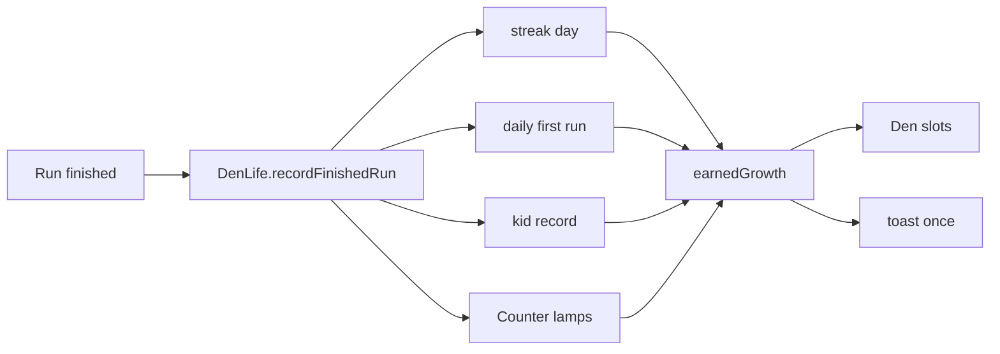

# ADR-0008 — Den Life

- Status: accepted (prompt 01; the owner approved the hero frames on 2026-10-26)
- Date: 2026-10-26
- Code: `packages/kit/src/{streak,versus,run,kids,patch-art,channels,daily,share}.ts`,
  `packages/kit/src/store/` (progress v3), `hall/src/app/{den-life,versus-night,power-run}.ts`,
  `hall/src/den/{growth,growth-art,den-life-layer}.ts`, `hall/src/{jacket,kids,versus,run}/`

## Context

Prompt 00 built a room that plays thirty games. Den Life gives the room a memory: a reason to switch
the console on each day, goals per game that are always in view, a jacket of patches, two-player
nights, six recurring opponents, and a room that grows with play. It has to stay local (no server),
gentle (rule 11: streaks forgive, no countdowns, no guilt), and shared by every game without each
game reinventing it.

## Decisions

### One data model, in the progress store (schema v3)

Everything Den Life remembers sits in `progress.den` (`DenLifeData`), next to the per-game progress:

| Field                | Holds                                                                               |
| -------------------- | ----------------------------------------------------------------------------------- |
| `streak`             | Covered days (`played` or `snow`) by UTC date, current and best                     |
| `daily`              | The first run of each game each day (score, emoji, channel), by date then game      |
| `kids`               | Wins, losses, draws and wins on A against each Neighbourhood Kid                    |
| `jacket`             | Patch placements (600×700 units, 15° steps, z order) and when it was last looked at |
| `versus`             | Series played, the last 20 series, rivalries by pair of names                       |
| `runs`               | Free-run records (best ten) and the first daily run of each day                     |
| `growthSeen`         | Which growth items have already sparkled in                                         |
| `counterCompletedAt` | When all 32 lamps first lit                                                         |

Settings v2 adds the two difficulty switches, `showGrowth`, `shareWithName`, `versusBestOf` and
`runSound`. Both migrations are lossless for existing data; "Forget my data" clears it all, growth
included, because growth is derived, never stored as objects in the room.

### Rules are pure kit functions; the Hall only applies them

Streak (`recordStreakDay`, `streakView`, `calendarMonth`), daily (`dailyChannel`, `recordDailyRun`),
versus (`startSeries` … `recordSeries`), the run (`planRun` … `recordRun`, `transitionTiming`), kids
(`aiSettings`, `recordKidResult`, `blockLadder`) and growth (`growthFacts`, `earnedGrowth`) are
deterministic functions of data and a clock, each with tests. The Hall's `DenLife` service is the
one place that folds a finished run into all of them at once, so every screen reads the same
answers.

### The streak forgives

A day counts when any run finishes. One automatic snow day per ISO week covers a single missed day;
a second miss leaves an empty square and nothing else: no "streak lost" copy, no countdown. Days in
the future (a clock moved back) are never awarded.

### The difficulty switches are per seat

`GameContext.difficulty` replaces the single Pro switch: `{ left, right }`, each `'A' | 'B'`, A is
hard as on the original console. Each game says what A means in its manifest (`difficulty`), and
whether a change applies mid-run. Gold thread on a patch means the earning seat's switch was on A.

### Channels: every original variation, plus Remix

Channels carry `kind: 'original' | 'remix'`, an optional `group`, and `originalGame` numbers.
Originals are always open; each Remix channel names the patch that opens it. `MAX_CHANNELS` is 64:
the largest original in the dossiers has 36 steps (27 for most), and 64 leaves room for a
Remix set without a second raise.

### Growth is data with fixed anchors

`hall/src/den/growth.ts` lists every item, what earns it and its toast. Each item is drawn at an
anchor chosen with the whole set in view (posters above the door, trophies in the short shelf rows,
lights along the shelves, ON AIR and the remote on the TV, the plaque on the Counter, the second
beanbag off the right edge), so a fully grown room still leaves the TV, the Counter and the labels
clear. `settings.showGrowth` hides it all without forgetting it.

### Series and runs live in memory until they finish

A Versus Night series and a Power Cycle Run pass through several screens (each game and back), so
they live in Hall services (`versusNight`, `powerRun`), not in a view. Only finished series and runs
are stored; closing the tab mid-way simply ends the night.

### The dev showcase

`?showcase=full|mid|new` (dev builds only) boots on a generated profile in an in-memory store, so
every screen can be judged before the games exist. `full` deliberately earns every growth item at
once. The build check fails if the showcase or any fixture id reaches `hall/dist`.

## Consequences

- A game supplies data, not systems: patches, Remix unlocks, micro-challenges, an emoji summary,
  what A means, and how it maps a Kid's personality onto its AI. The author's guide lists it.
- New growth items or rules are one data entry plus a drawing; nothing in the room is hand-placed.
- Everything stays in the browser; nothing is shared unless the player copies a share line.
