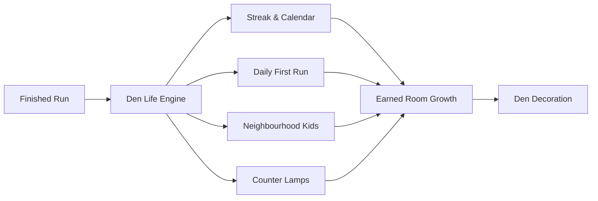

# Den Life

Den Life is the layer that runs across every game in Woodgrain '88. It gives the collection a memory: a game of the day, embroidered patches for a denim jacket, couch nights with a friend, six neighbourhood kids to beat, and a room that grows as you play. Everything is earned by playing, nothing is bought, and everything stays in your browser.

## Power Cycle of the day

Each day (by UTC) one game on the shelf is the Power Cycle of the day, with one of its channels picked for the day too. It is the same for everyone who plays that day.

Your first finished run of that game on any given day sets your official daily score. You can return and play the daily selection as many times as you like afterwards, but later attempts count as practice.

When you copy your daily result, it produces a single-line summary formatted by the daily share engine:

`Woodgrain '88 #12 · Tank Duel ch.7 · 3–1 · 🟩🟩🟥🟩`

If you enable the name option in settings, your chosen display name is appended to the end of the line:

`Woodgrain '88 #12 · Tank Duel ch.7 · 3–1 · 🟩🟩🟥🟩 · Robin`

By default, share lines remain anonymous.

## Streaks and the calendar

A day is counted toward your streak whenever you finish a run in any game or mode.

Streaks are designed to be forgiving:

- Each ISO week (Monday to Sunday), you receive one automatic snow day to cover a single missed day.
- If you miss only one day in a week, your streak continues unbroken, marked on the calendar with a snowflake symbol.
- If you miss a second day in the same week, that day remains an empty square. There are no penalty screens, countdown clocks, or lost-streak warnings.
- Future days are never awarded, and setting your system clock backwards will not corrupt existing records.

The wall calendar in the Den shows the current month. Opening it reveals the full month view, where you can inspect past days and check your current and best streaks. You can flip backwards up to twelve months using the arrow buttons or the `PageUp` and `PageDown` keys.

## Patches

Each game has three to five patches to earn, in four tiers. Their goals are published in the game's details.

| Tier   | Shape      | Purpose                                                         |
| ------ | ---------- | --------------------------------------------------------------- |
| Club   | Round      | An early milestone to welcome the player to the game.           |
| Pro    | Shield     | A substantial test of technique and competence.                 |
| Legend | Star-edged | Mastery of the game's most demanding feats.                     |
| Secret | Hexagon    | A hidden surprise with its true goal revealed only when earned. |

Every patch is drawn as real embroidery: a twill ground, a raised satin-stitch emblem and a merrowed border. A patch earned with your seat's difficulty switch on A is sewn in gold thread. If you first earn it on B, meeting its goal again on A turns it gold.

A patch you earn is stitched in on the results screen, needle and all. The jacket on the Den door glints until you next open it. Clicking any patch shows it up close: what earns it, how far along you are, and whether it is in gold.

## The jacket

Your denim jacket hangs on the Den door. Open it to see the front and the back, with your patch drawer beside it.

The jacket features full customisation:

- **Placement**: Drag patches freely from the drawer onto the jacket. They snap to clean placement spots across the chest, yoke, sleeves, and back panels.
- **Swapping and unsewing**: Dropping a patch onto an occupied spot swaps the two patches. Dropping a patch back into the drawer removes it from the garment.
- **Rotation**: Patches turn in 15° increments (from -165° to 180°).
- **Keyboard navigation**: Press `Enter` on a drawer tile to inspect and sew it to the nearest spot. On the jacket, `Enter` picks up a patch, arrow keys move it between spots, `R` and `Shift + R` rotate it, `Delete` or `Backspace` unsews it, and `Escape` cancels.
- **Drawer filters**: Filter by game, family (Duels, Brain, Sports, Arcade), tier, or gold thread.
- **Undo and redo**: Full editing history is supported with toolbar buttons or `Control + Z` and `Control + Y`.
- **Auto-arrange**: Neatly arranges your earned patches across the jacket. Legend patches take the centre of the back panel, followed by Pro, Club, and Secret patches ordered by slot. A quarter of the patches receive a slight 15° slant so the jacket looks hand-sewn rather than stamped by a machine.
- **Export**: Generates a shareable 1320×860 SVG card showing both sides of the jacket, copying it to your clipboard and downloading it as a file. Your name is included on the card only if you have enabled the name sharing setting.

## The difficulty switches

The console features two physical difficulty switches: the left switch for seat 1, and the right switch for seat 2.

- **Positions**: Position A is hard; position B is easy.
- **Controls**: Flip them by clicking, dragging left or right, or pressing `[` (left switch) and `]` (right switch).
- **Persistence**: Switch settings persist across sessions.
- **Meaning**: Each game details panel explains exactly what position A alters, such as narrowing paddles, increasing hazards, or giving the bot the first move.
- **Mid-run changes**: Switches can also be flipped from the pause menu. If a game specifies that changes are not live, flipping a switch mid-run takes effect from the start of the next round or match.

Playing with your seat's switch set to A sews earned patches in gold thread.

## Channels

Every variation of a game's original program is available as an original channel from your first visit ("Game 1–27 on the cartridge"). You never have to unlock standard cartridge variations.

Remix channels provide modern rules, alternate speeds, and fresh twists designed specifically for this collection. Each Remix channel is locked until you earn its corresponding patch in that game.

The TV dial, in a game's details and on its game menu, tunes four ways:

1. Drag the rotary knob, use your mouse scroll wheel, or press the arrow keys.
2. Select any variation directly from the channel strip.
3. Type the channel number on your keyboard and press `Enter`.
4. Press `S` to tune to a random surprise channel.

Each channel entry displays its cartridge game number and describes its rules.

## Power Cycle Run

The Power Cycle Run is five games in a row, with one short goal in each.

- **Structure**: Five games are selected at random, each presenting a 45-second micro-challenge.
- **Automatic flips**: Between rounds, the power switch flips automatically. Each transition accelerates by approximately 15% (`0.85^roundIndex`), quickening the screen collapse, cartridge swap, and goal reveal.
- **Scoring**: Failing a round scores 0. Passing scores 100 base points plus 10 points for each full second remaining on the clock.
- **Share line**: Share lines record your round passes and final score:
  `Woodgrain '88 Run #12 · ✅✅❌✅✅ · 4/5`
  For free runs, the run number is omitted:
  `Woodgrain '88 Run · ✅✅❌✅✅ · 4/5`
- **Records**: your own ten best free runs, and the first daily run of each day. There are no leaderboards.
- **Starting a run**: Hold the POWER lever or press and hold `P` for one second in the Den, or select the mode chip in the top bar.
- **Availability**: The run unlocks once at least five games on your shelf include micro-challenges.

## Versus Night

Versus Night brings head-to-head tournament play to a single machine.

- **Format**: Two players compete in a best-of-3 or best-of-5 series.
- **Raffle draw**: Games are drawn at random like a raffle from the shelf's versus titles, never repeating the game just played.
- **A Kid in seat 2**: with no second player, a Neighbourhood Kid can take seat 2 in any game that has a bot seat.
- **Chalkboard**: Scores, game selections, and tallies are drawn in chalk on the large framed blackboard.
- **Series climax**: The winner receives a chalk crown, and a Rematch button allows an immediate rematch while retaining player names.
- **Rivalries**: Head-to-head records between pairs of names are tracked across visits.
- **Draws**: A drawn game awards points to neither player; another game is drawn from the pool and played again.

## The Neighbourhood Kids

Six recurring bot personalities visit the Den, each with their own playing style and quirks:

| Name        | Style                              | Bio                                                                                                          |
| ----------- | ---------------------------------- | ------------------------------------------------------------------------------------------------------------ |
| Dee         | Fast, fearless, reckless           | Plays like the bell has already rung. First to the action, first to take a chance, and never sorry about it. |
| Moss        | Careful, patient, punishing        | Keeps her guard up and waits. Leave one door open and she walks straight through it.                         |
| Pip         | Wild, chaotic, sometimes brilliant | Nobody knows what Pip will do next, including Pip. Some days that turns out to be genius.                    |
| Grandpa Lou | Slow, steady, nearly flawless      | Takes his time, wipes his glasses, then does exactly the right thing. Every single time.                     |
| Rosa        | Tricky, baiting, sly               | Shows you one thing and does another. If a gap looks too easy, it was probably left there by Rosa.           |
| Benny       | The copycat who learns             | Watches how you play and plays it straight back at you, a little better every round.                         |

Their Polaroids are on the corkboard in the Den; clicking it opens the Kids screen with their bios, your record against each, and the Block Ladder. You climb it by beating each kid once, in any game: Pip at the bottom, then Benny, Dee, Rosa, Moss, and Grandpa Lou at the top.

Beating Grandpa Lou at the top makes you Block champion: a rosette goes up on the corkboard and the Den's own Block champion patch goes in your drawer, in gold thread once all six have been beaten with your switch on A. Wins on A also get a small gold "A" on the ladder.

## The Counter

The Counter beside the console has 32 lamps, one for each program on the 1988 cartridge:

- **Lamps 1 to 30**: Represent the 30 collection titles in their default versions. Each lamp illuminates as soon as you earn that game's first patch.
- **Lamps 31 and 32**: Represent the alternate cartridge versions of the two merged titles. These lamps light the first time you complete a finished run in that specific version.
- **All 32**: the lamps chase round once, the Counter rings its bell, and a brass "32 in 1" plaque appears on it, with a remote on the TV.

## The Den grows

As you explore the collection and reach milestones, the room itself earns decorations:

| Item              | What earns it                                | What appears                                             | Placement in room                        |
| ----------------- | -------------------------------------------- | -------------------------------------------------------- | ---------------------------------------- |
| Family posters    | Club patch in all playable games of a family | Illustrated 1980s posters (Duels, Brain, Sports, Arcade) | Wall above the door                      |
| Paper chain       | 7-day streak                                 | Colourful festooned paper chain                          | Draped across the window                 |
| String lights     | 30-day streak                                | Festoon bulb lights with night glow                      | Strung along Label Wall shelves          |
| ON AIR sign       | 100-day streak                               | Neon lightbox sign (glows at night)                      | Top of TV cabinet                        |
| Champion ribbon   | Becoming Block champion                      | A blue rosette                                           | Pinned to the corkboard                  |
| Second beanbag    | 10 finished Versus Night series              | A teal beanbag; the cat moves onto it                    | Floor, off the right edge                |
| Plaque and remote | Lighting all 32 Counter lamps                | Brass engraved plaque and TV remote                      | Plaque on counter, remote on TV          |
| Game trophies     | Legend patch in a game                       | Miniature gold trophy with game's band colour            | Shelf gaps in short rows, then shelf top |

The setting "Show what the room has grown" allows you to hide these items at any time without resetting or losing any earned progress.

## Settings

Den Life includes four specific configuration settings:

1. **Show what the room has grown**: Toggle room decorations on or off. Hiding items forgets nothing.
2. **Put my name on share lines**: Appends your display name to copied share lines. Disabled by default.
3. **Versus Night length**: Sets the default tournament length to best of 3 or best of 5.
4. **Power Cycle Run sound**: how loud the run's automatic flips are: Quiet, Normal or Loud.

## Controls

The Den can be navigated completely by mouse or keyboard:

| Control                        | Mouse / Pointer                       | Keyboard                                     |
| ------------------------------ | ------------------------------------- | -------------------------------------------- |
| Cycle power (next game)        | Click or drag power switch right      | `P`                                          |
| Cycle power (previous game)    | Drag power switch left                | `Shift + P`                                  |
| Start Power Cycle Run          | Hold power switch for 1 second        | Hold `P` for 1 second                        |
| Restart what is on the TV      | Click RESET lever                     | `Enter` or `Space` on RESET lever            |
| Toggle left difficulty switch  | Click or drag left switch             | `[`                                          |
| Toggle right difficulty switch | Click or drag right switch            | `]`                                          |
| Navigate room hotspots         | Click TV, calendar, jacket, or boards | `Tab` / `Shift + Tab`                        |
| Navigate Label Wall            | Hover to tune TV, click to open card  | `Arrow` keys, `Enter` to open card           |
| Tune TV channel dial           | Drag knob, scroll wheel, click strip  | `Arrow` keys, type digits + `Enter`, `S`     |
| Flip calendar month            | Click month flip buttons              | `PageUp` (earlier), `PageDown` (later)       |
| Jacket: pick up / sew          | Drag and drop patch                   | `Enter` or `Space`                           |
| Jacket: move patch             | Drag across snap spots                | `Arrow` keys                                 |
| Jacket: turn patch             | —                                     | `R` (clockwise), `Shift + R` (anticlockwise) |
| Jacket: unsew patch            | Drag patch back to drawer             | `Delete` or `Backspace`                      |
| Jacket: undo / redo            | Click Undo / Redo toolbar buttons     | `Control + Z`, `Control + Y`                 |
| Pause menu / Leave game        | Click pause icon                      | `Esc`                                        |
| List view / Shortcuts          | Click top bar icons                   | `L` (list view), `?` (shortcuts)             |

## Your data

Woodgrain '88 is built local-first. All gameplay statistics, streak records, jacket layouts, and settings reside exclusively inside your browser's local storage.

- **No remote servers**: The game makes no network requests, tracks no telemetry, and requires no account.
- **Exporting**: You can download a complete backup of your progress at any time as a JSON save file.
- **Importing**: Save files can be restored through an import preview dialog that summarises runs, patches, and games before replacing existing data.
- **Resetting**: Selecting "Forget my data" in the settings panel clears all stored progress, wiping Den Life records, statistics, and room decorations back to day one.
