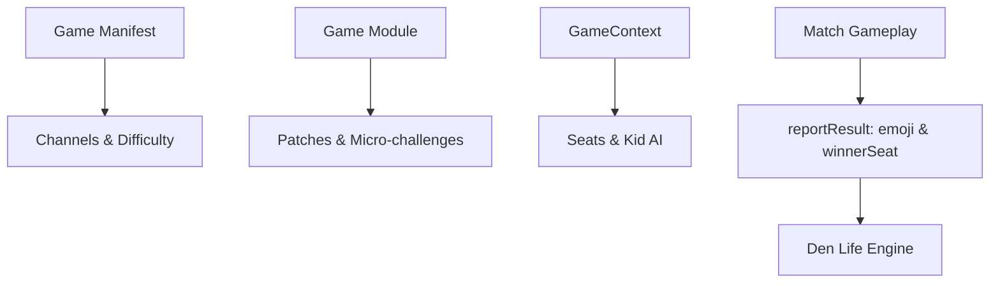

# Den Life for Games

This guide explains how games integrate with Den Life, the collection-wide system of Woodgrain '88. Individual games do not implement save files, streaks, or tournament managers. Instead, each game exports declarative metadata and hooks into the kit's contracts so the Den can orchestrate daily play, patches, micro-challenges, and bot opponents consistently.



## Checklist

Every game supplies data through its manifest and its module:

| Item                | Location | Requirement                                                                                          |
| ------------------- | -------- | ---------------------------------------------------------------------------------------------------- |
| Cartridge identity  | Manifest | Unique `id`, `slot` (1–30), `title` (≤22 chars), `tagline` (≤80 chars), and `teaser` (≤320 chars).   |
| Visual presentation | Manifest | Palette `accent` (day and night), 24×24 SVG `emblem`, and code-drawn `label` specification.          |
| Player modes        | Manifest | Player count `players` (`1P`, `1–2P`, `2P`) and versus mode `versus` (`none`, `local`, `local+bot`). |
| Channels            | Manifest | Array of `ChannelDef` variations (1–64 channels; at least one original variation).                   |
| Feature support     | Manifest | Support flags `supports: { daily, challengeLinks, microChallenges }`.                                |
| Difficulty switches | Manifest | Optional `difficulty: { left, right?, liveChange }` describing positions A and B.                    |
| Event definitions   | Manifest | Schema array `events: GameEventSchema[]` with numeric fields for metric tracking.                    |
| Cartridge versions  | Manifest | Optional `versions: CartridgeVersion[]` (minimum two) for merged cartridge programs.                 |
| Patches             | Module   | Array of 3–5 `PatchDef` goals (at least one Club, Pro, Legend; at most one Secret).                  |
| Micro-challenges    | Module   | Array of `MicroChallengeDef` goals (required if `supports.microChallenges` is true).                 |
| How to play card    | Module   | Instructions card `howToPlay: HowToPlayCard` with goal, controls, and tips.                          |
| Mount and demo      | Module   | Lifecycle functions `mount(host, context)` and silent TV attract loop `demo(host, seed, context)`.   |
| Result reporting    | Module   | Single call to `context.reportResult` with score, win status, and summary `emoji`.                   |
| Bot AI mapping      | Module   | Translates `SeatInfo.kid` via `aiSettings` whenever a bot occupies a seat.                           |

## Channels

Channels represent game variations. Players tune them with a rotary TV dial rather than selecting numbers from a flat menu.

Every channel is defined by `ChannelDef`:

- `id`: Unique kebab-case string, stable forever. Records, progress and challenge links are keyed by it.
- `kind`: `'original'` for classic cartridge variations, or `'remix'` for custom modern rules.
- `title`: Short title (1–24 characters).
- `description`: Single descriptive line (1–90 characters).
- `group`: Optional header (1–20 characters) grouping channels on the dial strip.
- `originalGame`: Optional array of original cartridge game numbers (1–64) for original variations.
- `unlockedBy`: Kebab-case patch identifier from the same game that unlocks this Remix channel. Forbidden on original channels.

Rules for channel design:

- Every variation of the original cartridge program must be included as an original channel and unlocked by default.
- Games can offer up to 64 channels (`MAX_CHANNELS`).
- Channel identifiers must never be renamed or reordered once published.

## Difficulty switches

The original console featured physical difficulty switches for each player: left for seat 1, right for seat 2. In Woodgrain '88, position A represents hard and position B represents easy.

Declare switch support in `manifest.difficulty`:

- `left`: Object with `a` and `b` descriptions (1–60 characters each).
- `right`: Optional switch meaning for seat 2 in versus titles.
- `liveChange`: Set `true` if changes apply during play, or `false` if they wait for the next round or game.

Reading switch state during play:

```ts
const switches = ctx.difficulty.get();
const isHard = switches.left === 'A';
```

Listen for changes via `ctx.difficulty.onChange((switches) => { ... })`. When `liveChange` is `false`, the game must buffer the new setting and apply it only after the active point, round, or game concludes.

A patch earned while the earning seat's switch is on A is sewn in gold thread; the game does nothing for this beyond emitting its events.

## Patches

Each game exports between three and five patches in `module.patches`. Goals measure metrics across gameplay events:

- **Tier distribution**: Every game must include at least one Club, one Pro, and one Legend patch. It may include at most one Secret patch.
- **Titles**: Maximum 28 characters.
- **Descriptions**: Clear explanations of the goal. Secret patches require a `hint` string, which is displayed until earned.
- **Goals**: Defined by `PatchGoal`:
  - `metric`: `{ kind: 'count', event }`, `{ kind: 'max', event, field }`, or `{ kind: 'sum', event, field }`.
  - `target`: A positive, finite threshold.
  - `channel` and `mode`: Optional constraints to restrict progress to specific variations or run modes.

Thresholds are published directly in game details so players know their exact objectives. Patch artwork is generated automatically from the game's label colours and SVG emblem; games do not draw patch graphics.

## Micro-challenges

Micro-challenges are bite-sized objectives used by the Power Cycle Run. Games supporting them declare `supports.microChallenges: true` in the manifest and export `module.microChallenges`.

Each definition specifies:

- `id`: Unique kebab-case identifier.
- `channel`: Channel identifier where the challenge takes place.
- `title`: Short name (1–32 characters).
- `goal`: Imperative instruction (e.g. "Catch 5 dots").
- `seconds`: Challenge length between 15 and 90 seconds (defaults to 45).
- `pass`: Target condition matching an event metric.

When a micro-challenge starts, `ctx.run.micro` provides `{ id, goal, seconds }`. The game must launch immediately into active play on the specified channel without opening a title screen. The Hall manages the countdown clock and pass or fail banners, but the game must cleanly conclude when time runs out.

## Emoji summary

When completing any run, games report a summary string in `GameResult.emoji` passed to `ctx.reportResult`. This string appears in daily and run share lines.

Requirements:

- Length: Up to 12 emoji grapheme clusters.
- Permitted characters: Pictographs, flags, keycaps, and coloured squares or circles (e.g. `🟩`, `🟥`, `🟨`, `🟢`).
- Forbidden: Letters, digits, punctuation, or player-entered text.
- Validation: Sanitised by `emojiSummary(text)`, returning `null` if disallowed characters are present.

Examples include round win-loss markers (`🟩🟩🟥🟩`) or items collected (`🟢🟢🟢`).

## Seats and the Kids

Multiplayer and bot games read seat assignments through `ctx.seats: readonly SeatInfo[]`. When a seat has `kind === 'bot'`, `seat.kid` identifies which Neighbourhood Kid is playing.

Games translate kid personalities into AI knobs using `aiSettings(kid, ranges)`:

- `DEFAULT_AI_RANGES`: Sets default bounds for `reactionMs` ([900, 150] ms), `errorRate` ([0.02, 0.35]), and `memory` ([0, 12] rounds). Games may override these ranges to suit their pace.
- `errorRateForRound(settings, draw)`: Scales error probability up or down during hot and cold spells using a pseudo-random number from `ctx.rng.next()`.

Each personality trait influences AI behaviour:

| Trait         | Meaning             | How game AI should reflect it                                         |
| ------------- | ------------------- | --------------------------------------------------------------------- |
| `aggression`  | Offensive intent    | Charges forward, attacks early, and prioritises scoring over defence. |
| `caution`     | Defensive focus     | Guards positions, avoids risky gambits, and stays near safety lines.  |
| `reaction`    | Response speed      | Sets latency between game events and bot reactions.                   |
| `error`       | Frequency of slips  | Introduces input delays, misses targets, or selects suboptimal paths. |
| `randomness`  | Unpredictability    | Deliberately picks secondary options to avoid being read.             |
| `patience`    | Willingness to wait | Bides time until a high-percentage opening appears.                   |
| `deception`   | Fakes and trickery  | Feints moves, baits attacks, or disguises true directions.            |
| `adaptivity`  | Learning capacity   | Memorises player habits over recent rounds to counter them.           |
| `streakiness` | Volatility of form  | Broadens performance swings between winning and losing streaks.       |

Benny has `mirrorsPlayer: true`. Games that can adapt should copy the human player's tactics, move choices, or symmetry.

### The Kids' memory

The Kids do not have perfect recall. A game whose Kids must remember things (clues, cards played,
the board) keeps those things in a `KidMemory` from `kids/memory` (ADR-0011), and its AI reasons
only over what the memory gives back.

1. **Choose a profile.** Use `memoryProfile(kid, mode)`. The mode is the player's Kid memory
   setting: `'human'` (each Kid's own memory, from `KID_MEMORY`) or `'sharp'` (perfect recall,
   offered as the harder option).
2. **Describe your facts** with a `FactAdapter`:
   - `key(fact)`: facts with the same key are the same fact, so seeing it again refreshes it.
   - `distort(fact, rng)`: a slightly wrong version, close to the truth. A distance off by one, an
     arrow turned a notch, a card's rank one away.
3. **Feed it** as the match goes:
   - `observe(fact, salience, now)` for what the Kid found itself;
   - `witness(fact, salience, now, rng)` for what the other player revealed. It is noticed only with
     the Kid's attention, and is otherwise logged as missed.
   - Use `salienceOf(profile, 'own' | 'theirs', striking)` for the salience. Striking facts
     (bombs, surprises, big swings) stick better.
4. **Ask it** with `recall(now, rng)` when the Kid decides. Faint facts are forgotten for good.
   Faded ones may slip this time, or come back slightly wrong. Fresh ones come back exactly.
5. **Show it.** `summary()` lists what the Kid kept, forgot, misremembered and missed, for a "What
   the Kid remembered" panel on the results screen.

`now` is seconds on the match clock, and `rng` a seeded stream of the Kid's own, so matches replay
exactly. When the rules put everything on the table anyway (Hot & Cold's Notebook mode), skip the
memory. Let the Kid take in only `profile.capacity` facts per decision instead, its reading budget.

| Kid   | Capacity | Half-life | Distortion | Attention | Rehearses |
| ----- | -------- | --------- | ---------- | --------- | --------- |
| Lou   | 9        | 120 s     | 2%         | 90%       | yes       |
| Moss  | 7        | 90 s      | 4%         | 80%       | yes       |
| Rosa  | 6        | 60 s      | 6%         | 85%       | no        |
| Benny | 6        | 60 s      | 5%         | 95%       | no        |
| Dee   | 4        | 30 s      | 10%        | 50%       | no        |
| Pip   | 3        | 20 s      | 18%        | 40%       | no        |

Distortion is the chance of a mix-up once a fact has faded completely. A fact one half-life old is
mixed up half as often.

## Versus

Games supporting two players set `manifest.versus` to `'local'` (two humans on one machine) or `'local+bot'` (human versus human or bot).

When reporting results in versus play:

- Single-player wins set `won: boolean`.
- Versus matches set `winnerSeat: Seat | null` (1 or 2, or `null` for a draw).

Versus Night automatically includes all playable games where `versus !== 'none'` in its tournament raffle. In a Versus Night game, always report `winnerSeat`, also when a Kid sits in seat 2. A game that reports only `won` is read from seat 1's side: true means seat 1 won, false seat 2, and neither a draw.

## Worked example

The following excerpts demonstrate how test fixtures implement Den Life contracts.

### Channel definitions (`catch-game.ts`)

Channels can be grouped and mapped to original cartridge program numbers:

```ts
const channels: ChannelDef[] = CHANNEL_GROUPS.flatMap((group, groupIndex) =>
  Array.from({ length: 6 }, (_, index) => {
    const num = index + 1;
    const slotNumber = groupIndex * 6 + num;
    return {
      id: `${group.toLowerCase()}-${num}`,
      kind: 'original' as const,
      title: `${group} ${num}`,
      description: `${group} pace, variation ${num}.`,
      group,
      originalGame: [slotNumber],
    };
  }),
);
```

### Micro-challenges (`catch-game.ts`)

Micro-challenges specify their channel and passing metric:

```ts
const microChallenges: readonly MicroChallengeDef[] = [
  {
    id: 'catch-five',
    channel: 'slow-1',
    title: 'Catch Five',
    goal: 'Catch 5 dots',
    pass: { metric: { kind: 'count', event: 'catch' }, target: 5 },
  },
  {
    id: 'streak-four',
    channel: 'slow-1',
    title: 'Streak Four',
    goal: 'Reach a streak of 4',
    pass: { metric: { kind: 'max', event: 'catch', field: 'streak' }, target: 4 },
  },
];
```

### Difficulty switches and results (`fake-game.ts`)

Switch positions modify gameplay, and results include summary emoji:

```ts
const resolvePaddleHeights = (): [number, number] => {
  const switches = ctx.difficulty.get();
  return [
    paddleHeightForSeat(basePaddleHeight, switches.left),
    paddleHeightForSeat(basePaddleHeight, switches.right),
  ];
};

ctx.reportResult({
  score: court.score[0] * 100 + court.hits,
  scoreLabel: `${court.score[0]}–${court.score[1]}`,
  durationMs: Math.round((elapsed - startedAt) * 1000),
  won: winner === 0,
  ...(versus ? { winnerSeat: winner === 0 ? 1 : 2 } : {}),
  emoji: pointEmojis.join(''),
  presentation: 'hall',
});
```

### Secret patches (`turn-game.ts`)

Secret patches provide a hint until earned:

```ts
const patches: readonly PatchDef[] = [
  {
    id: 'first-win',
    tier: 'club',
    title: 'First Win',
    description: 'Win one match.',
    goal: { metric: { kind: 'count', event: 'win' }, target: 1 },
  },
  {
    id: 'perfect-draw',
    tier: 'secret',
    title: 'Cat Game',
    description: 'Achieve three draws.',
    hint: 'Share the board three times in peace.',
    goal: { metric: { kind: 'count', event: 'draw' }, target: 3 },
  },
];
```

### Bot AI mapping and mirroring (`turn-game.ts`)

Bot moves combine the kid's error rate for the round, mirroring and deception. In outline (the fixture's own code spells each step out):

```ts
export function pickBotMove(
  board: readonly (Seat | null)[],
  seat: Seat,
  settings: AiSettings,
  draw: number,
  lastHumanMove: number | null,
): number {
  // A slip this round: play away from the best move.
  if (draw < errorRateForRound(settings, draw)) return aMoveThatIsNotTheBest;
  // Benny: answer the player's last move with its mirror image when it is free.
  if (settings.mirror && lastHumanMove !== null && board[8 - lastHumanMove] === null)
    return 8 - lastHumanMove;
  // Otherwise the best move, with Rosa's deception choosing a bait now and then.
  return theBestMove;
}
```
