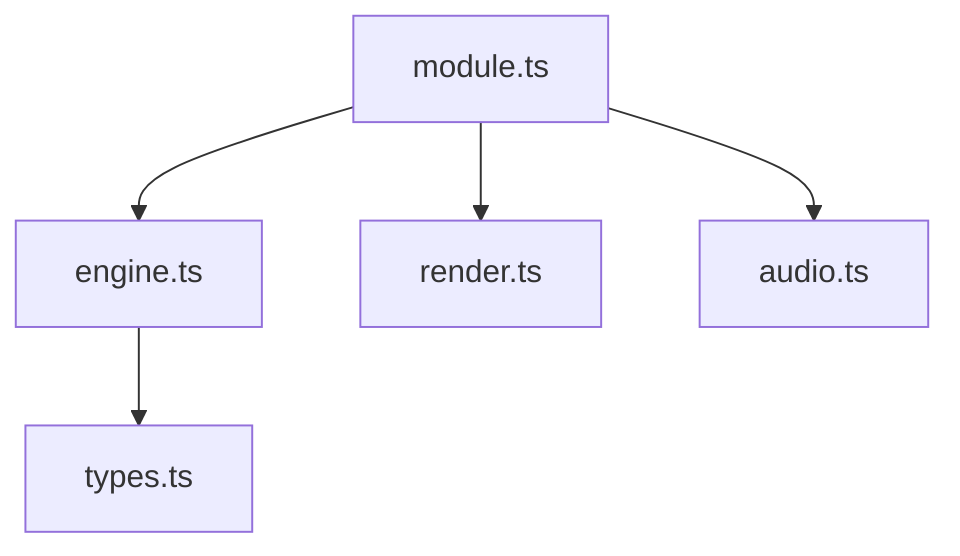
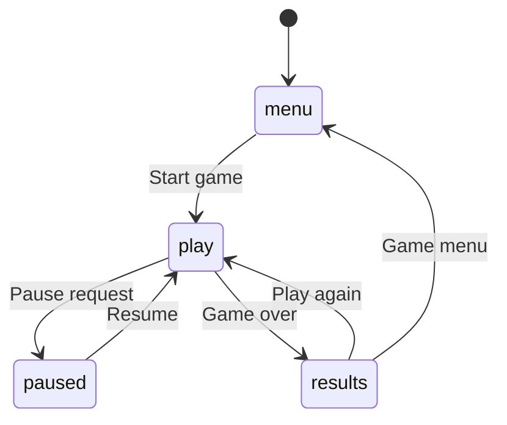

# <Game title> — Architecture

_Technical architecture, runtime lifecycle, state contracts, and event pipelines._

## Module map

_Overview of internal module boundaries and dependency relationships._

## State machines

_Top-level game lifecycle states and transitions._

## Engine and determinism

_Simulation tick loop, fixed-step integration, seeded RNG usage, and deterministic replay guarantees._

## AI and bots

_Bot heuristic evaluation, decision timers, Neighbourhood Kid rival archetypes, and difficulty tuning._

## Events

_Event schema declarations emitted through GameContext.emit for tracker systems._

| Type | Fields | When         |
| ---- | ------ | ------------ |
| type | fields | When emitted |

## Channels

_Curated game variations, initial configurations, and channel unlock conditions._

## Patches

_Data-driven patch definitions mapping event metrics to Club, Pro, Legend, and Secret targets._

## Micro-challenges

_Fast 45-second micro-challenge configurations for Power Cycle Run integration._

## Rendering

_Canvas or SVG visual pipelines, theme colour mappings, and visual layer composition._

## Audio

_Synthesized WebAudio sound cues, procedural instruments, and sound event bindings._

## Tests and simulations

_Automated Vitest test suites, headless monte carlo balance sweeps, and physics invariants._

## Kit candidates

_Reusable algorithms or UI components identified for extraction into shared kit packages._
