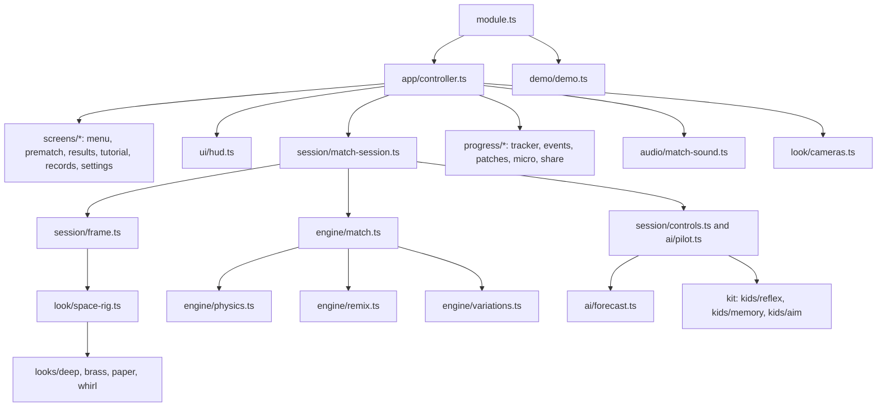
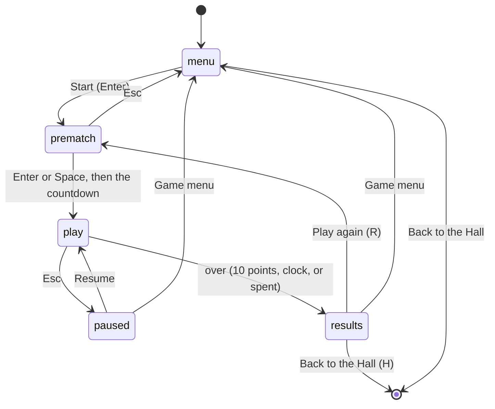

# Gravity Duel — Architecture

_For programmers: how the game is put together, where everything lives, and how to change it._

## Module map

## State machines

A match itself has two phases, `playing` and `over`. After `over` the field keeps drifting under
gravity while the results show.

## Engine and determinism

- **Pure TypeScript** in `src/engine/`, no DOM, no clock, no `Math.random`.
- **One tick is one 20 ms PAL frame.** Everything is in whole numbers:
  - positions in subpixels (256 to a step of the 160 × 90 field);
  - velocities in fine units (256 to a speed unit, a sixteenth of a step a tick).

  `NOTES.md` has the units and every verified rule.

- **`physics.ts`** has the arithmetic of one body:
  - the speed fold;
  - the thrust and muzzle vectors (our own functions of the heading);
  - the gravity law (inverse-square, fitted to the cartridge);
  - moving with wrap or bounce;
  - turning with the tap-then-repeat cadence;
  - fuel burns;
  - touching circles.
- **`match.ts`** runs a tick in the cartridge's order:
  1. per seat: cloak burn and toggle, then (uncloaked) fire, turn, thrust and touches;
  2. countdowns and mutual reload;
  3. spins;
  4. moving;
  5. gravity on this tick's body;
  6. the clock.

  It emits `MatchEvent`s for the session, the sound and the progress tracker.

- **`remix.ts`** has the four Remix rules. Their bodies are positioned from the tick, and the
  comet's passes are drawn from the match's seeded stream by the engine before anything else can
  ask.
- **Determinism.** A match is a pure function of its setup and the controls fed to it. Daily runs,
  challenge links and replays rely on it, and `tests/match-combat.test.ts` checks it after 5,000
  ticks.

## AI: the Neighbourhood Kids

`src/ai/pilot.ts` decides ten times a second (see `NOTES.md`, The Kid pilots, for the order of
its concerns). It uses:

- `forecast.ts`: the real physics, run forward on scratch bodies;
- `perception.ts`: what the Kid can see, and its memory of the bars;
- `styles.ts`: each Kid's habits;
- the kit's reflexes (when its hands act), memory (what it believes of the bars) and aim (lead
  share and overshoot).

Each decision is kept as a `PilotMoment` for the results panel's "How the Kid flew it". Balance is
checked by `src/sim/` (headless matches and sweeps), `scripts/simulate.ts` and the locked bands in
`tests/sim/balance.test.ts`.

## Events

| Type         | Fields                                         | When                                       |
| ------------ | ---------------------------------------------- | ------------------------------------------ |
| `point-won`  | `bend`, `afterCloak`, `frugal`                 | The player scores                          |
| `point-lost` | —                                              | The rival scores                           |
| `dock`       | `inMatch`, `switchA`                           | The player docks                           |
| `near-star`  | `seconds`                                      | A stretch of flying close to the star ends |
| `refuel`     | `speed`                                        | The player's ship touches the starbase     |
| `match-won`  | `duel`, `vsKid`, `fuelLeft`, `louOrbit`, `kid` | The player wins                            |
| `match-lost` | `kid`                                          | The player loses                           |

`progress/tracker.ts` turns engine events into these. It gathers a tick's events and judges them
in `observe`, because a hit and its point can arrive in either order within a tick.

## Channels

`src/channels.ts`:

- **17 originals** with their cartridge numbers, grouped Duel (1–7), Docking race (8–13) and Solo
  docking (14–17);
- **four Remix channels:**
  - Binary Stars, opened by Lou's Orbit;
  - Comet, opened by Soft Dock;
  - Asteroid Belt, opened by Ghost Kill;
  - Last Fuel, opened by Fuel Miser.

Ids are stable forever.

## Patches

`src/progress/patches.ts`:

- **Club:** First Contact, Soft Touch;
- **Pro:** Ghost Kill, Fuel Miser, Soft Dock;
- **Legend:** Lou's Orbit;
- **Secret:** Slingshot, Hot Landing.

The collection plan allows one secret patch; this prompt asked for two, as Trailblaze's did.

## Micro-challenges

`src/progress/micro.ts`, 45 seconds each:

- Three docks (Solo Rendezvous);
- Round the star (The Star);
- Close to the sun (The Star);
- Light touch (Open Space).

## Rendering

- **The contract** is `src/look/look.ts`:
  - the session hands a view a `SceneFrame` each frame, interpolated between ticks and never across
    a wrap (`session/frame.ts`);
  - moments arrive as `ViewMoment`s.
- **`look/space-rig.ts`** does what every look shares (ADR-0016):
  - figures and trails;
  - the 64-frame spin;
  - the cloak fade;
  - the trajectory guide's dots.
- **Each look** in `src/looks/<look>/` supplies its world, ships, missiles, trails, pods, the
  middle (star, starbase or beacon), Remix bodies, bursts and small moments.

| To change                   | Look in                                                                                                                |
| --------------------------- | ---------------------------------------------------------------------------------------------------------------------- |
| A ship's design             | `looks/<look>/ships.ts` (Paper's are drawings in `looks/paper/drawings.ts`)                                            |
| The star                    | `looks/deep/star.ts`, `looks/brass/orrery.ts`, the sun in `looks/paper/drawings.ts`, the eye in `looks/whirl/water.ts` |
| Starbase, beacon, pods      | `looks/<look>/stations.ts` (Paper: `drawings.ts` and `view.ts`)                                                        |
| Remix bodies                | `looks/<look>/remix.ts` (Paper: `view.ts`)                                                                             |
| Bursts and moments          | `looks/<look>/view.ts` (Deep: `burst.ts`)                                                                              |
| Light and finish per look   | `looks/<look>/look.ts`                                                                                                 |
| Cameras (Follow, hit nudge) | `look/cameras.ts`                                                                                                      |

## Audio

`src/audio/sounds.ts` has one synthesised palette per look, with the same cues in all four. The
two engines are pitched a fourth apart, after the cartridge's two engine notes.
`src/audio/match-sound.ts` maps engine events to cues and holds each engine while it thrusts.

## Tests

| Area                  | Files                                                                                                                               |
| --------------------- | ----------------------------------------------------------------------------------------------------------------------------------- |
| Engine                | `tests/physics.test.ts`, `match-setup`, `match-combat`, `match-docking`, `hooks` (an independent check, one test per hook), `remix` |
| AI                    | `tests/ai/forecast.test.ts`, `pilot.test.ts`                                                                                        |
| Simulations           | `tests/sim/*` (determinism, seat swapping, the perfect docker, locked balance bands)                                                |
| Session               | `tests/session/*`                                                                                                                   |
| Progress              | `tests/progress/*`                                                                                                                  |
| Channels and manifest | `tests/channels.test.ts`, `tests/manifest.test.ts`                                                                                  |
| App                   | `tests/app`, `screens`, `ui`, `demo`                                                                                                |
| End to end            | `e2e/` on port 5523 (`pnpm --filter @woodgrain-88/gravity-duel e2e`, shots with `SHOTS=1`)                                          |

Dev pages on port 4523:

- `play.html`: the bench, any look, variation and pilots;
- `hero.html`: the hero scenes, with `?centre`, `?pods`, `?remix`, `?cloak`, `?zoom` and `?at`;
- `wire.html`: the wireframe;
- `game.html`: the real module with a fake Hall.
