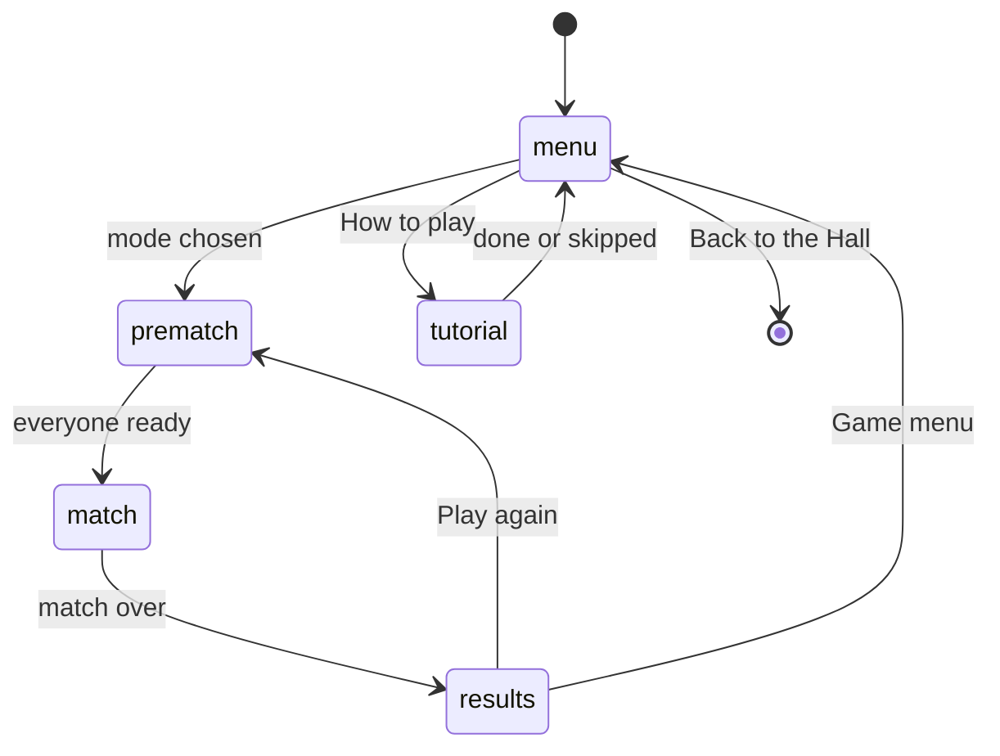
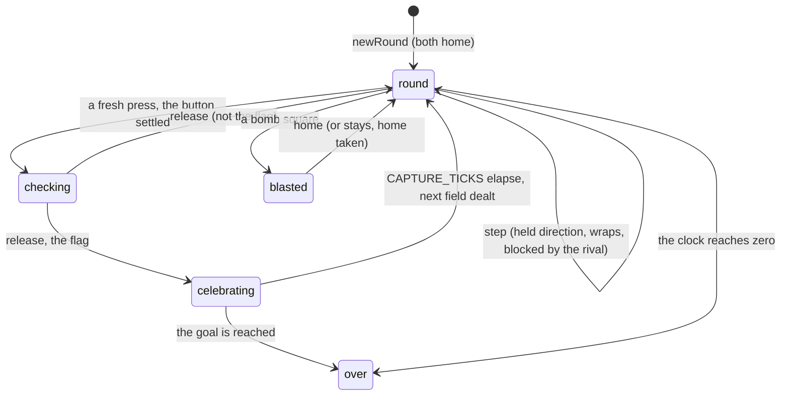

# Hot & Cold — Architecture

_For programmers: how the game is put together, where each visual and sound is defined, and how to
change them._

## Module map

```mermaid
flowchart LR
  subgraph Rules
    engine[engine/: grid, board, flag, match, rules, solver]
  end
  subgraph Hunters
    ai[ai/: kid, path, plan, styles, facts]
  end
  subgraph Play
    session[session/: match-session, controls, mouse, result]
  end
  subgraph Picture
    look[look/: the FieldView contract, field-space, heat, glyphs, looks, seats, confetti]
    looks[looks/: polar, tabletop, radar]
  end
  subgraph App
    app[app/: controller, save, settings]
    screens[screens/ + ui/hud]
    progress[progress/: events, tracker, patches, micro]
    audio[audio/: sounds, match-sound]
    copy[copy/kid-lines]
  end
  kit[(@woodgrain-88/kit)]
  arena[(@woodgrain-88/arena)]
  engine --> session
  ai --> session
  session --> look
  look --> looks
  looks --> arena
  session --> progress
  session --> audio
  app --> session
  app --> screens
  app --> copy
  ai --> kit
  progress --> kit
  app --> kit
```

| Folder                                                | What lives there                                                                                                                                                                                                                                                                                                                                                                                                         |
| ----------------------------------------------------- | ------------------------------------------------------------------------------------------------------------------------------------------------------------------------------------------------------------------------------------------------------------------------------------------------------------------------------------------------------------------------------------------------------------------------ |
| `src/engine/`                                         | The rules, pure and deterministic: the 9 × 7 field (`grid.ts`), the seeded field layout and clue reading (`board.ts`), a moving flag's bounce and wrap (`flag.ts`), `createMatch`/`stepMatch` (one tick, `match.ts`), the ten variations and their timings (`rules.ts`), and the hidden-flag solver (`solver.ts`). No DOM, no clock, no randomness beyond the `Rng` it is handed.                                        |
| `src/ai/`                                             | A Neighbourhood Kid playing from a seat (`kid.ts`), what it remembers of a check and how a memory misremembers it (`facts.ts`), getting about the wrapped field round the rival (`path.ts`), choosing where to check next (`plan.ts`), and each Kid's numbers, plus the simulations' perfect hunter (`styles.ts`).                                                                                                       |
| `src/session/`                                        | `match-session.ts` runs a match from real frame time in fixed ticks, feeds the seats and the look, and keeps what the rules leave to the screen: which clues are showing, the possibility fog, a micro-challenge's time limit. `controls.ts` turns the kit's input into a step and the reveal button; `mouse.ts` turns a click into a walk and a check; `result.ts` turns a finished match into the Hall's `GameResult`. |
| `src/look/`                                           | The shared picture machinery: the `FieldView` contract a look implements (`look.ts`), the field's place in the world (`field-space.ts`), the warm-to-cool clue colours and their colour-blind ramp (`heat.ts`), run-time glyph textures (`glyphs.ts`), the three looks by id and their stage (`looks.ts`), the two seats' colours (`seats.ts`), and the shared confetti burst (`confetti.ts`).                           |
| `src/looks/<look>/`                                   | One folder per look: Polar Expedition, Tabletop Board, Radar Room. Each has its own `look.ts` (the `LookDefinition`), `view.ts` (the `FieldView`), and the pieces that draw its world, its clues, its explorers and its capture.                                                                                                                                                                                         |
| `src/progress/`                                       | Den Life: `events.ts` (the schema), `tracker.ts` (turns a match's events into them), `patches.ts` (the patches), `micro.ts` (the Power Cycle Run challenges).                                                                                                                                                                                                                                                            |
| `src/app/`, `src/screens/`, `src/ui/`                 | `app/controller.ts` mounts the game inside the Hall: menu, pre-match, match, results, the tutorial. `app/save.ts` is the save slot; `app/settings.ts` the game's own settings. `screens/` holds the menu, pre-match, records, results, settings sheet, tutorial and their shared sheet and style. `ui/hud.ts` is the in-match HUD.                                                                                       |
| `src/audio/`                                          | `sounds.ts`: one palette per look, synthesised by the kit. `match-sound.ts`: maps match events to a cue, panned to the square it happened on.                                                                                                                                                                                                                                                                            |
| `src/copy/`                                           | `kid-lines.ts`: each Kid's own lines for a win, a loss and a draw, and its memory summary's voice.                                                                                                                                                                                                                                                                                                                       |
| `src/channels.ts`, `src/manifest.ts`, `src/module.ts` | The ten cartridge channels and four Remix channels; what the Hall shows before the game loads; the `GameModule` the Hall mounts.                                                                                                                                                                                                                                                                                         |
| `src/demo/`                                           | `demo.ts`: the Den TV's attract loop, two Kids racing on the Polar look.                                                                                                                                                                                                                                                                                                                                                 |
| `src/dev/`                                            | Dev-only pages: `game.ts` (a whole match via a fake context and chrome), `hero.ts` (scripted scenes for art review), `fake-context.ts`, `fake-chrome.ts`.                                                                                                                                                                                                                                                                |
| `src/sim/`                                            | `play.ts` (plays a whole match headless) and `measure.ts` (the solver, hunt and duel measurements behind the balance notes and tests).                                                                                                                                                                                                                                                                                   |

## State machines



A paused match shows the pause menu's items (Look, Clues, Change channel in a normal run) over the
match; it is not a separate view and the field keeps standing behind it.



Turns and hunt for hunt add a hand-off: `release` on a miss calls `passTurn` (turns) or
`countCheck` (hunt for hunt, which can end the hunter's run and, the first time, hand the other
seat one last equal turn before the match ends).

## Engine and determinism

Every duration is counted in ticks of `TICK_SECONDS` (2 / 50.77 s, about 39 ms), the original's own
per-seat update, so a pause lasts exactly as long as it did in 1978 (`rules.ts`: `STEP_TICKS`,
`SLOW_STEP_TICKS`, `SETTLE_TICKS`, `TURN_DELAY_TICKS`, `BOMB_TICKS`, `CAPTURE_TICKS`,
`CLOCK_TICK_TICKS`). `createMatch` builds a `Match` from a `MatchSetup` (the rules, the seats, the
difficulty switches, a seed); `startMatch` lays the first field; `stepMatch(match, inputs)` advances
one tick and returns what happened as `MatchEvent`s.

- **The field generator** (`board.ts`: `generateBoard`) is a seeded shuffle of the 63 squares that
  keeps the cartridge's composition (1 flag, 8 bombs, 27 distances, the rest arrows); a distance or
  an arrow is worked out at the moment it is checked (`clueAt`), against wherever the flag is then,
  so a moving flag keeps every clue honest.
- **The solver** (`solver.ts`) keeps every story of the flag consistent with what has been checked:
  for a still flag, the square it started on; for a moving one, the square and heading it started
  with, carried forward move by move (`believe`, `trackStories`). It is used for the possibility
  fog, the simulations' perfect hunter, and (through `ai/plan.ts`) every Kid's planning.
- **Where each variation's rules live:** `engine/rules.ts`'s `CARTRIDGE_VARIATIONS` holds the ten
  variations as `{ style, motion, goal, composition, flags, flagSteps, singleHunt }`;
  `src/channels.ts` wraps each in a `ChannelDef` and adds the four Remix channels on top of the race
  rules. `shortened()` gives the Short match length. `slowsStepsOnA` and `doublesChecksOnA` say
  where the difficulty switch does anything.
- **A check is resolved flag first:** `match.ts`'s `check()` reads `clueAt`, which checks the flag
  square before the board's own kind, so a flag standing on a bomb square is captured safely.

## AI and bots

The Neighbourhood Kids (`ai/kid.ts`) play from a seat exactly as a person would: they hold
directions and the reveal button, one tick at a time, and only know what a player in their seat
could know.

- **Facts** (`ai/facts.ts`): what a Kid remembers about one check — the square, the clue, how often
  the flag had moved. `FACT_ADAPTER.distort` misremembers a recalled fact close to the truth (a
  square next door, a distance off by one, an arrow turned a notch), through the kit's memory model
  (`@woodgrain-88/kit`, `kids/memory`, ADR-0011).
- **Memory** (`kids/memory`, in the kit): each Kid has a `KidMemory<Fact>` built from its profile
  (`KID_MEMORY`, documented in NOTES.md) and `FACT_ADAPTER`. In Classic Memory a Kid's checks are
  `observe`d and the rival's `witness`ed (subject to the profile's `attention`); it `recall`s facts
  when it plans. In Notebook every clue stays on the field, so `ai/kid.ts`'s `readField` reads only
  as many as the profile's `capacity` allows, its own checks first (the rival's first for Rosa and
  Benny).
- **The solver's stories**: `ai/kid.ts`'s `plan()` turns what a Kid currently believes (recalled
  facts, or the field it reads) into a `FlagBelief` via `engine/solver.ts`'s `believe`.
- **The value of a square** (`ai/plan.ts`'s `chooseTarget`/`valueOf`): a weighted sum of the
  chance the flag is there, how much a check there would tell (`expectedInformation`), the steps to
  walk there (only where time matters: race and clock), a remembered bomb nearby, and the rival (a
  lead in the race to a square, or the pull of its last check).
- **Where each Kid's style is set:** `ai/styles.ts`'s `HUNT_STYLES` holds every tuned number per
  Kid (`think`, `stepPause`, `read`, `flagWeight`, `infoWeight`, `travelCost`, `commitAt`,
  `bombShy`, `wander`, `checkOnTheWay`, `contest`, `fumble`); `PERFECT_STYLE` is the simulations'
  non-Kid perfect hunter. `ai/path.ts`'s `nextMove` walks the shortest way round the wrapped field
  and round the rival.

## Events

`session/match-session.ts` listens to every `MatchEvent` the engine emits (`round`, `step`,
`blocked`, `check`, `release`, `home`, `capture`, `final-turn`, `score`, `turn`, `clock`, `over`)
and drives the look, the HUD and the sound from them. `app/controller.ts` reports progress only
from seat 1's side, through `progress/tracker.ts`, which turns the match's events into Den Life's
own:

| Type             | Fields                                                    | When                                                          |
| ---------------- | --------------------------------------------------------- | ------------------------------------------------------------- |
| `capture`        | `checks`, `clean`, `streak`, `onLastCheck`                | Seat 1 found a flag.                                          |
| `bomb`           | —                                                         | Seat 1 checked a bomb square.                                 |
| `hunts-progress` | `flagsWithin12`                                           | Hunting alone, another flag found within the first 12 checks. |
| `match-won`      | `vsKid`, `mossTurnsClassic`, `louMovingClassicOnA`, `kid` | Seat 1 won a two-seat match.                                  |
| `match-lost`     | `kid`                                                     | Seat 1 lost a two-seat match.                                 |

## Channels, patches, micro-challenges

`src/channels.ts` defines the ten cartridge channels (`game-1` to `game-10`, each wrapping a
`cartridgeRules` variation) and four Remix channels, each unlocked by a patch and built on the race
rules with one field changed: Two Flags (`flags: 2`), Minefield (double bombs), Thin Ice
(`clueFadeSeconds: 10`), Drift Storm (`motion: 'bounce'`, `flagSteps: 2`). Channel ids never change;
records, challenge links and progress are keyed by them. `DAILY_RULES` is a single still-flag hunt
(`singleHunt: true`).

`progress/patches.ts` (`HOT_COLD_PATCHES`) holds two Club patches, three Pro (each opening a Remix
channel: Minefield, Thin Ice, Two Flags), one Legend (opening Drift Storm) and one Secret, each
measured from one field of the events above. `progress/micro.ts` (`HOT_COLD_MICRO_CHALLENGES`)
holds four 45-second challenges: three on the clock channel (one flag, two flags, a flag without a bomb) and a race against Dee on channel 1.

A Remix channel's rule reaches the engine the same way every channel's does: `channels.ts` builds
its `Rules` once, and `app/controller.ts`'s `rulesForRun()` hands that `Rules` straight to
`createMatchSession`, which passes it to `createMatch`. The engine itself does not know "Remix"; it
only ever sees a `Rules` value.

## Rendering

`look/look.ts`'s `FieldView` is the contract every look implements (ADR-0014): `placeExplorer` and
`walk` (one step, wrapping included) and `nudge`; `reveal` and `conceal` for a clue; `blast` and
`sendHome` for a bomb; `capture` and `showFlag` for the end of a hunt; `setFog` for the possibility
fog. The view owns its models and effects and decides nothing; `session/match-session.ts` is the
only caller. Every look places square (column, row) at the same spot
(`look/field-space.ts`'s `squareCentre`), so the mouse, the Kids' paths and the tests never ask
which look is showing.

Each look is a `LookDefinition` (`look/look.ts`): its framing, light mood, finish and exposure
per appearance, a background colour, and `createView`. `look/looks.ts`'s `createLookStage` builds
the arena stage from it. A view can be swapped mid-match (`MatchSession.setAppearance`, `setLook`),
which is how an appearance change (repaint only) and a look change (a new stage, since each look has
its own light) work; the controller disposes the old stage once the session has moved its view
across.

Clue colour comes from one shared heat palette (`look/heat.ts`): warm to cool by distance (1 to 8),
with a colour-blind-safe ramp. Where each visual lives per look:

| Look             | World                                                                                                    | Clue pieces                                                                                                     | Explorers                                                       | Bomb                                                           | Capture                                                                                 |
| ---------------- | -------------------------------------------------------------------------------------------------------- | --------------------------------------------------------------------------------------------------------------- | --------------------------------------------------------------- | -------------------------------------------------------------- | --------------------------------------------------------------------------------------- |
| Polar Expedition | `looks/polar/snowfield.ts` (snow, survey, camps), `camp.ts` (tents, sleds)                               | `clue-pieces.ts` (numeral slabs, arrow markers, craters, the flag)                                              | `explorer.ts` (parka figure, poses)                             | `view.ts`'s `blast` (snow plume, crater)                       | `view.ts`'s `capture` (raised flag, confetti, a night flare)                            |
| Tabletop Board   | `looks/tabletop/board.ts` (tray, felt, tiles, notepad, hourglass, pegboard)                              | `faces.ts` (painted tile faces: numerals, arrows, bomb, star)                                                   | `pawn.ts` (turned wooden pawn)                                  | `view.ts`'s `blast` (tile flip to the bomb face, cartoon puff) | `view.ts`'s `capture` (star tile, a pennant on a pin, confetti, tiles jostling outward) |
| Radar Room       | `looks/radar/console.ts` (steel desk, instrument cluster), `scope-face.ts` (the printed plot, the sweep) | `strokes.ts` (vector strokes: seven-segment range, bearing arrow) via `view.ts`'s `rangeSymbol`/`bearingSymbol` | `view.ts`'s blips (a diamond for seat 1, a triangle for seat 2) | `view.ts`'s `blast` (a static burst, the blip snapped home)    | `view.ts`'s `capture` (a closing target lock, rolling pings)                            |

To change a look's colours or shapes, edit its own folder's files; the heat palette, the field
geometry and the seat colours (`look/seats.ts`) stay shared. To add a fourth look, add a folder
implementing `FieldView` and register it in `look/looks.ts`; the rules, the session and the tests
are untouched.

## Audio

`audio/sounds.ts` holds one palette per look (`POLAR`, `TABLETOP`, `RADAR`), synthesised by the
kit's audio engine, with the same meaning behind the same cue name in all three: `step`, `check`,
`distance` (its pitch climbs as the flag gets nearer, via `distancePitch`), `arrow`, `bomb`,
`home`, `bump`, `turn`, `tick`, `flag`. `audio/match-sound.ts`'s `createMatchSound` maps each
`MatchEvent` to its look's cue, panned to the square it happened on
(`panAt`); `setLook` switches every cue to the new look's palette for a live look change
mid-match.

## Tests and simulations

- `tests/grid.test.ts`, `tests/flag.test.ts`, `tests/board.test.ts`, `tests/solver.test.ts`: the
  field's geometry, a moving flag's bounce and wrap, field generation and clue reading, and the
  belief solver (prior, narrowing, contradictions, expected information).
- `tests/match.test.ts`: every variation's play style, stepping and settle timing, blocking, bomb
  blasts, moving and still flags, turn sharing, hunt-for-hunt's equal-turns rule, the clock,
  single-hunt challenges, determinism.
- `tests/ai.test.ts`: getting about the wrapped field round the rival, and a Kid playing a match
  through `sim/play.ts`'s `playMatch`.
- `tests/session.test.ts`: controls (diagonals added only where free), the mouse's walk, the
  progress events, and how a finished match reads as a `GameResult`.
- `tests/channels.test.ts`: the Hall's channel groups.
- `tests/save.test.ts`, `tests/settings.test.ts`: save round-tripping and resilient parsing;
  settings defaults, per-field fallback, granular updates.
- `tests/screens-sheets.test.ts` (`@vitest-environment happy-dom`): the settings sheet and the
  records screen.
- `tests/balance.test.ts`: the opt-in balance targets, run with
  `HC_BALANCE=1 pnpm vitest run --project hot-and-cold games/hot-and-cold/tests/balance.test.ts`;
  otherwise only the always-on solver and field checks run.
- `tests/helpers/drive.ts`: driving a match by hand in a test (holding a direction, walking to a
  square and checking it).
- `src/sim/measure.ts` and `scripts/simulate.ts` (documented in NOTES.md): the solver, hunt and
  duel measurements behind the balance notes, reproducible with `tsx scripts/simulate.ts`.

Run `pnpm exec vitest run --project hot-and-cold`.

## Kit candidates

None yet. The Kids' memory model (`kids/memory`, ADR-0011) already lives in the kit, built for this
game and meant for later ones; nothing new in this game's own modules has been identified as ready
to share.
