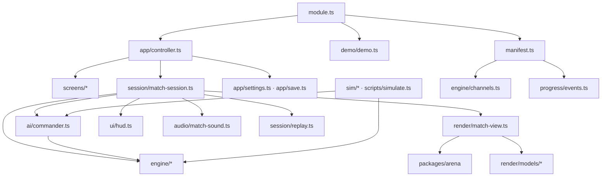
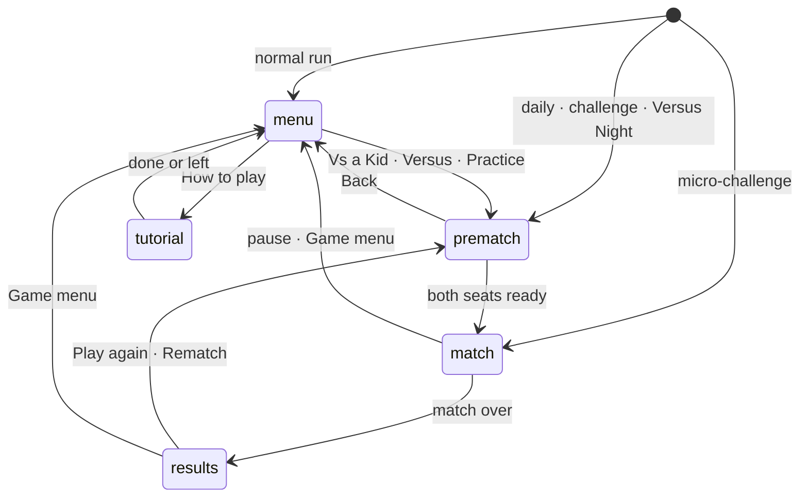
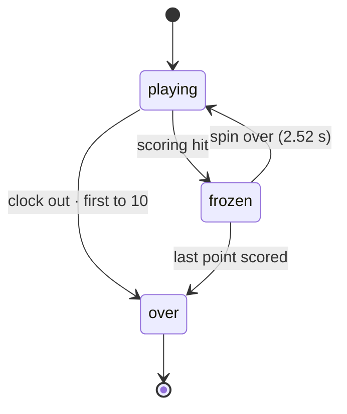
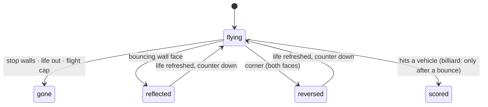

# Tank Duel — Architecture

Tank Duel is a pure, fixed-step engine with a three.js diorama drawn around it. The engine knows
nothing about the screen, so the same matches run in a browser, in a headless simulation, inside
the Den's TV and in tests.

## Module map

| Folder             | What lives there                                                                                                                                      |
| ------------------ | ----------------------------------------------------------------------------------------------------------------------------------------------------- |
| `engine/`          | Pure rules and state: vectors, walls and traces, shells, vehicles and controls, the match state machine, visibility, rules constants, the 31 channels |
| `arenas/`          | Our own boards: the Open Field, the Sandbag Line, the Old Quarter, the Bumper Yard, and the cloud skies; their format and validation                  |
| `ai/`              | The Neighbourhood Kids: perception, navigation, the aim planner, personality mapping, the tuning table, the commander                                 |
| `sim/`             | Headless duels, the scripted novice, a still target and sweeps for balance work                                                                       |
| `session/`         | One match on screen (`match-session.ts`), the replay recorder, the result builder, the practice aim line                                              |
| `render/`          | The diorama: boards, skies, models, the match view, framing                                                                                           |
| `ui/` · `screens/` | The HUD, and the menu, pre-match, results, records, settings, tutorial and shared styles                                                              |
| `audio/`           | The sound palette and the match's sound                                                                                                               |
| `progress/`        | Events, patches and micro-challenges                                                                                                                  |
| `app/`             | The controller (screen flow and run modes), game settings, the save slot                                                                              |
| `dev/`             | Dev-only pages: hero scenes, wireframe play, the game harness with a fake context                                                                     |

## State machines

The visit, as the controller runs it:

A match in the engine (`engine/match.ts`):

A shell meeting a wall (`engine/walls.ts`, `engine/shell.ts`):

## Engine and determinism

- **Stepping.** `stepMatch(state, [stick0, stick1], dt, world)` returns a new state and the step's
  events; nothing is mutated. The kit loop calls it at 60 Hz, and rendering interpolates between
  the last two states.
- **Sticks.** Both seats are sticks of the same shape (`StickInput`), whether a person, a Kid's
  commander or a script drives them. Every bit of randomness comes from seeded kit `Rng` streams
  forked per seat, so a seed replays a match exactly.
- **Units.** The board is 64 × 40 units in 2-unit cells. Headings are sixteen steps.
- **Conversion.** Numbers were converted from the original's 50 Hz frames in `engine/rules.ts`,
  and each tuned value says why.

## AI and bots

- **One commander for all six Kids** (`ai/commander.ts`). It perceives only through the visibility
  rules (`ai/perception.ts`): an unseen tank keeps its last sighting, and a plane in a cloud is
  not seen.
- **Each decision, in order of priority:**
  1. dodge a shell on a collision course;
  2. steer its own guided shell, holding the line while a wall is in the way;
  3. hunt an enemy unseen for a while;
  4. take a wild shot (the random kids);
  5. take a planned shot;
  6. otherwise move: to a firing spot near its favourite range, into cover after a hit, or wander.
- **The aim planner** (`ai/aim.ts`) traces every heading's shell through its bounces, leads moving
  targets, and treats a barrel through a wall as the engine does.
- **Personality** comes from the kit's `kids` data, through `ai/personality.ts` and the tuning
  table `ai/tuning.ts`. It sets how often a Kid decides, how it misjudges range, lead and banks,
  how steadily it steers, how close it fights, how readily it dodges and takes cover, and how deep
  it plans banks.
- **Tuning.** The table was searched against the balance targets with seeded simulations; see
  [NOTES.md](NOTES.md) and [SIMULATIONS.md](SIMULATIONS.md).

## Events

| Type         | Fields                                                               | When                                               |
| ------------ | -------------------------------------------------------------------- | -------------------------------------------------- |
| `hit`        | `bounces`, `banked`, `billiard`, `points`                            | Seat 1 scores                                      |
| `hit-taken`  | —                                                                    | Seat 1 is hit                                      |
| `match-won`  | `vsKid`, `invisible`, `jet`, `louInvisibleMazeOnA`, `loneJet`, `kid` | Seat 1 wins a match                                |
| `match-lost` | `kid`                                                                | Seat 1 loses a match                               |
| `survived`   | —                                                                    | A survival micro-challenge ends with seat 1 unhurt |

`progress/events.ts` turns engine events into these. Practice emits nothing.

## Channels

- `engine/channels.ts` lists all 31 channels as rules, and `manifest.ts` turns them into kit
  `ChannelDef`s with the one-line copy from `copy/channel-lines.ts`.
- The 27 originals carry their game number. The four Remix channels add a `RemixRule` and are
  opened by patches.

## Patches

There are seven `PatchDef`s in `progress/patches.ts`, each a metric over the events above:

| Tier   | Patches                      |
| ------ | ---------------------------- |
| Club   | Rookie Commander, Ricochet   |
| Pro    | Bank Manager, Ghost, Top Gun |
| Legend | Grandpa's Respect            |
| Secret | Lone Wolf                    |

## Micro-challenges

There are five, of 45 seconds each, in `progress/micro.ts`. A micro-challenge run skips the menu,
ends at its time limit and leaves the banner to the Hall.

## Rendering

- **`packages/arena`.** The shared toolkit (see its ADR) gives:
  - the stage, with a fair tilted orthographic camera, the day and night light rigs, soft shadows
    and post-processing;
  - particles and ribbons;
  - ground paint for soot, tracks and contact shadows;
  - explosions and camera shake.
- **What the game adds:**
  - `render/board.ts` builds the terrain board;
  - `render/sky.ts` builds the countryside and the clouds;
  - `render/models/*` builds the painted tank, biplane, bomber and jet;
  - `render/match-view.ts` keeps it all in step with the engine and never draws a hidden vehicle.
- **Fixed and per-scene parts.** One stage lives for the whole visit. Each match builds its own
  view on it; an appearance change rebuilds the view, and the stage swaps its light rig.
- **Screens are DOM** over the canvas, styled by `screens/style.ts` with `--td-*` tokens for both
  appearances.

## Audio

- **Every sound is synthesised by the kit's audio engine** (`audio/sounds.ts`).
  - One-shots: shots, the ricochet ping pitched up per bounce, the explosions at a different pitch
    per side, the click of each turning step, the spin, the fuse ticks, radar and the fanfare.
  - Held voices: engine and propeller hums pitched by speed and panned by position.
- **Hidden vehicles make no sound.** The kit's `hold()` API was added in this prompt for the hums.

## Tests and simulations

- Unit tests cover:
  - the engine rules and hooks;
  - the arenas' validation;
  - the aim planner on fixed scenes;
  - the commander, perception and navigation;
  - the replay, results, settings, save and progress data;
  - the screens (in happy-dom);
  - the dev harness.
- `tests/balance.test.ts` locks the balance targets with tolerances, and checks that every Kid
  scores on a tank that never moves. It runs on seeds the tuning never saw and only with
  `TANK_BALANCE=1`.
- `scripts/simulate.ts` writes [SIMULATIONS.md](SIMULATIONS.md): every channel and every Kid
  pairing.

## Kit candidates

- **The aim planner** (`ai/aim.ts`, heading sweep with bounces and lead) would suit any later duel
  with bouncing shots.
- **The replay recorder and cursor** (`session/replay.ts`) are game-agnostic in all but the hit
  ranking.
- **The screens' enamel-plate style** could become a kit "tabletop" theme if a second diorama
  game wants it.
