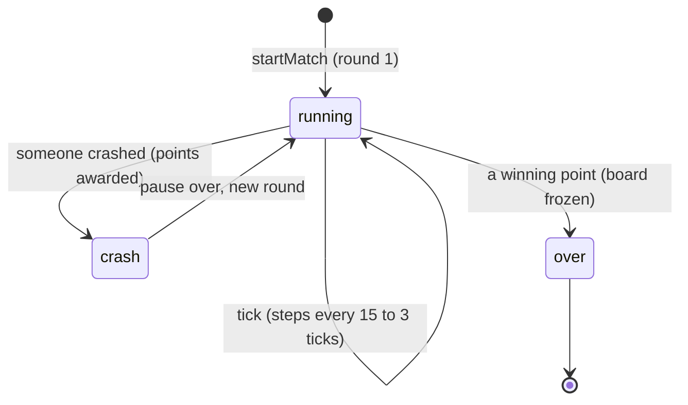
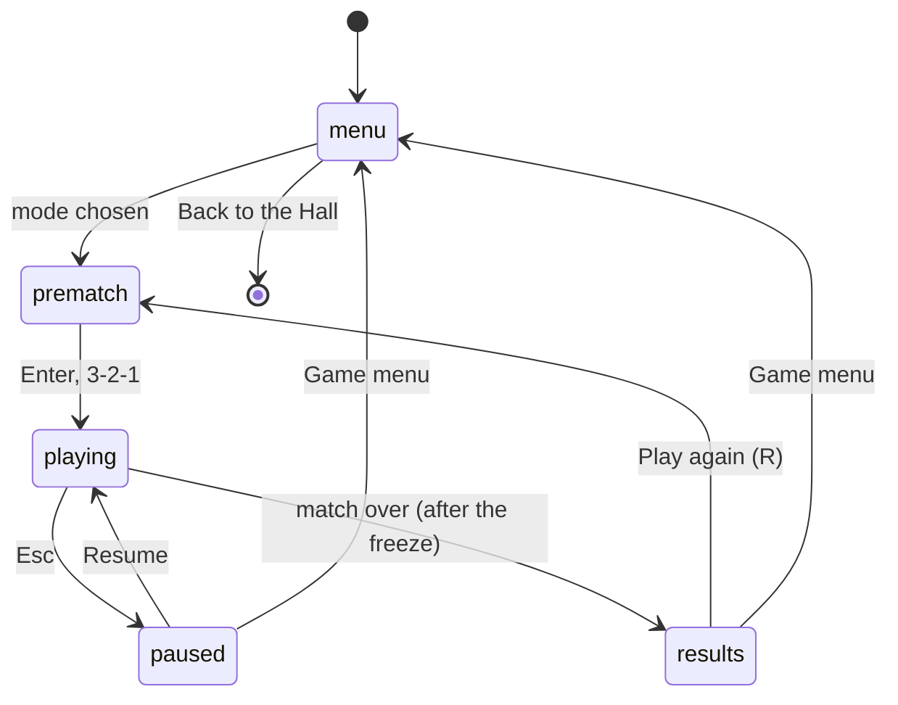

# Trailblaze — Architecture

_For programmers: how the game is put together, where each visual and sound is defined, and how to
change them._

## Module map

```mermaid
flowchart LR
  subgraph Rules
    engine[engine/: grid, headings, variations, match, remix, space]
  end
  subgraph Riders
    ai[ai/: kid, perception, computer-1977]
    controls[session/controls]
  end
  subgraph Play
    session[session/match-session + trap]
  end
  subgraph Picture
    look[look/: trail-rig, sweep, swept-trail, crossing, remix-pieces, chase-camera]
    looks[looks/: neon, trains, mummy, ice]
  end
  subgraph App
    app[app/: controller, settings, save]
    screens[screens/ + ui/hud]
    progress[progress/: events, patches, micro, tracker, share]
    audio[audio/: sounds, match-sound]
    doodle[doodle/: board, svg]
  end
  kit[(@woodgrain-88/kit)]
  arena[(@woodgrain-88/arena)]
  engine --> session
  ai --> session
  controls --> session
  session --> look
  look --> looks
  looks --> arena
  session --> progress
  session --> audio
  app --> session
  app --> screens
  app --> doodle
  ai --> kit
  progress --> kit
  app --> kit
```

| Folder                                | What lives there                                                                                                                                                                                                      |
| ------------------------------------- | --------------------------------------------------------------------------------------------------------------------------------------------------------------------------------------------------------------------- |
| `src/engine/`                         | The rules, pure and deterministic: the 40 × 20 grid, headings and steering, the 14 variations, `stepMatch` (one 20 ms tick), the Remix rules (`remix.ts`), flood fills (`space.ts`). No DOM, no clock, no randomness. |
| `src/ai/`                             | Who steers besides people: `computer-1977.ts` (the cartridge's rider, as a step pilot), `kid.ts` (a Neighbourhood Kid with human reflexes), `perception.ts` (what a Kid can see).                                     |
| `src/session/`                        | `match-session.ts` runs a match from real frame time in fixed ticks, feeds drivers and the view, spots traps (`trap.ts`) and keeps the stats. `controls.ts` turns the kit's input into sticks.                        |
| `src/look/`                           | The shared picture machinery: the rig that animates riders and lays trail pieces, the curve and sweep geometry, the Remix walls and lanes, the Chase camera, the seat colours.                                        |
| `src/looks/<look>/`                   | One folder per look: its world, trail pieces, rider figures, watcher, crash and trap effects.                                                                                                                         |
| `src/progress/`                       | Den Life: events, patches, micro-challenges, the tracker that turns a match into events, and the share line.                                                                                                          |
| `src/app/`, `src/screens/`, `src/ui/` | The controller, settings, save data, the menus and screens, the in-match HUD.                                                                                                                                         |
| `src/audio/`                          | The four sound palettes and the event-to-sound mapping.                                                                                                                                                               |
| `src/doodle/`                         | Packing a board into a short string, and drawing it as an SVG.                                                                                                                                                        |
| `src/demo/`                           | The Den TV's attract loop.                                                                                                                                                                                            |
| `src/dev/`                            | Dev-only pages: `play.html` (a whole match), `hero.html` (scripted scenes), `perf.html` (a full board), `demo.html` (the TV), `screens.html` (screens over a live duel).                                              |

## State machines



Four Way changes one arrow: a crash does not end the round while two or more riders are still
riding; the round ends when at most one remains.



## Engine and determinism

Time is counted in ticks of 20 ms, the cartridge's own frames, so every duration is an integer. A
step comes every 15 ticks at the start of a round, falling by 3 every 256 ticks on speed-up
channels. `stepMatch(match, sticks)` advances one tick and returns what happened as events
(`round`, `step`, `turn`, `speed`, `shrink`, `crash`, `point`, `over`). Inputs are latched between
steps. The session runs ticks from real frame time with an accumulator and drops time after a
stall, so a match plays the same at any frame rate. NOTES.md lists every timing and quirk with the
test that pins it.

## AI and bots

- **Computer 1977** (`ai/computer-1977.ts`) is a `StepPilot`: at each step, after trails are
  laid, it counts free cells along four rays and picks the longest, exactly as the cartridge does,
  quirks included. It is not a Kid and has no reflexes.
- **Kids** (`ai/kid.ts`) decide each step and when they notice a rival's turn, and act through the
  kit's `kids/reflex` (ADR-0012):
  - perception within an awareness radius, with the rival's bike and its path treated as walls;
  - plans made from where the Kid will be when its hands act;
  - foreseen walls timed, surprises reacted to;
  - turns kept safe across the hands' timing;
  - a reaction's worth of open road ahead.

  The planning style weights (space, safety, cut-off, mirror) give each Kid its character. NOTES.md
  ("How the Kids ride", "Simulations") has the model and the tuned values.

## Events

The session emits the engine's events plus `trap` (a rider sealed in a pocket of at most 40 cells).
The view, the sound, the HUD, the progress tracker and the Kids all listen to the same stream.
Den Life events (`progress/events.ts`) describe the player's rider: `point-won`, `point-lost`,
`ride`, `solo-cells`, `match-won`, `match-lost`, `doodle-exported`.

## Channels

`src/channels.ts` defines the 14 cartridge channels (`game-1` to `game-14`) and the five Remix
channels, each with its rules. Ids never change; records, challenge links and progress use them.

## Patches

`src/progress/patches.ts`: two Club, three Pro (each opening a Remix channel), one Legend (opening
Four Way and Ghost Trails) and two Secret. Each goal reads one numeric event field, which is why
the events carry derived fields such as `boxedIn` and `speedUpSeconds`.

## Micro-challenges

`src/progress/micro.ts`: four 45-second challenges on channels 1, 3 and 8.

## Rendering

Rendering uses three.js through `@woodgrain-88/arena`: a stage with a tilted orthographic table
camera, light rig, bloom and reflections. Each look is a `LookDefinition` (`look/look.ts`): its
framing, light mood, finish and exposure, a background colour per appearance, and `createView`.

A view is built by `look/trail-rig.ts` from the look's parts (ADR-0013):

- The rig animates each rider across its cell along a curve (`look/crossing.ts`) during the step
  after the rules moved it.
- It lays the crossed cell as trail when the next step comes, and plays crashes.
- It also handles the Remix walls and lanes and Ghost Trails.

Where each visual lives:

| Look         | World                      | Trail                             | Riders      | Watcher        | Crash and trap                       |
| ------------ | -------------------------- | --------------------------------- | ----------- | -------------- | ------------------------------------ |
| Neon Grid    | `looks/neon/arena.ts`      | `walls.ts` (swept ribbons)        | `bike.ts`   | `host.ts`      | `view.ts` (blast, shards, shockwave) |
| Toy Trains   | `looks/trains/playroom.ts` | `track.ts` (bed, sleepers, rails) | `loco.ts`   | `conductor.ts` | `view.ts` (clonk star, headlamps)    |
| Mummy's Wrap | `looks/mummy/tomb.ts`      | `bandage.ts` (linen strip)        | `mummy.ts`  | `priest.ts`    | `view.ts` (bow, lightning)           |
| Ice Trail    | `looks/ice/lake.ts`        | `ice-wall.ts` (ridge and core)    | `skater.ts` | `snowman.ts`   | `view.ts` (frost, crystals)          |

To change a look's colours, edit its view and trail files. Seat colours are in `look/seats.ts`.
To add a look, add a folder with a `LookDefinition` and register it in `look/looks.ts`.

A view can be swapped mid-match (`MatchSession.setView`), which is how look and appearance changes
work. Appearance changes rebuild the view; look changes rebuild the stage too.

## Audio

`src/audio/sounds.ts` holds one palette per look, synthesised by the kit's audio engine:

- a hum per rider, which climbs with the speed-up;
- cues for turn, gap, crash, point, trap, win and the countdown.

`src/audio/match-sound.ts` maps session events to cues, panned to where they happen. To change a
sound, edit its `SoundDef` in the palette. The meaning of each cue stays the same across looks.

## Tests and simulations

- `tests/engine/`: every rule, quirk and Remix rule, plus a 300-run fuzz.
- `tests/ai/`: Computer 1977's choices and the Kid rider. `fixtures/duel-decisions.json` pins a
  duel's Kid decisions, so engine changes cannot quietly change how Kids play.
- `tests/session/`, `tests/progress/`, `tests/app/`, `tests/screens/`, `tests/audio/`,
  `tests/doodle/`: the rest of the game.
- `tests/sim/`: the opt-in balance targets (`TRAILBLAZE_BALANCE=1`) and the 100 000-stream engine
  fuzz (`TRAILBLAZE_FUZZ=1`).
- `src/sim/` and `scripts/simulate.ts`: headless duels and sweeps.

Run `pnpm exec vitest run --project trailblaze`.

## Kit candidates

- `look/chase-camera.ts`: following a figure with the arena's fixed table camera by sliding the
  world. Tank Duel's close-ups could use it.
- `doodle/board.ts`: packing a small grid into a URL-safe string, for any game that shares a board.
- `sticks.ts` and `kids/reflex.ts` already moved to the kit in this prompt.
